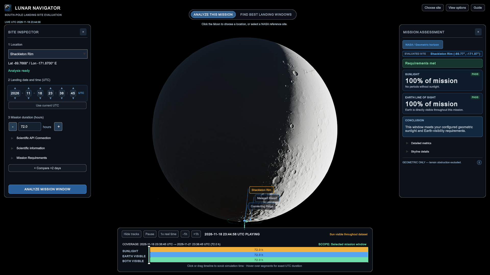

# LunarNavigator

**Lunar south-pole mission planning and visualization · v1.1.1 · Windows x64**

**[Download LunarNavigator for Windows](https://github.com/Solayman-Sameh/lunar-navigator/releases/download/v1.1.1/LunarNavigator_Setup.exe)**

Download and run `LunarNavigator_Setup.exe`. **Unity and Python are not required.**
**[Watch / download the narrated demo](https://github.com/Solayman-Sameh/lunar-navigator/releases/download/v1.1.1/LunarNavigator_Demo.mp4)**

[Release notes and checksum](https://github.com/Solayman-Sameh/lunar-navigator/releases/tag/v1.1.1).

Explore the Moon, choose a reference site or custom coordinate, and compare sunlight
and direct-to-Earth visibility over a mission window. LunarNavigator combines a
Unity 6 HDRP interface with a local Python service that obtains NASA/JPL Horizons
ephemerides.



*Unity Play Mode capture of the v1.1.1 source after a real NASA/JPL analysis for
Shackleton Rim, 18 November 2026 at 23:38:45 UTC, 72 hours. Terrain is illustrative;
analysis is geometric only.*

## Install and run

1. Open the [v1.1.1 release](https://github.com/Solayman-Sameh/lunar-navigator/releases/tag/v1.1.1).
2. Download **LunarNavigator_Setup.exe**. The old standalone ZIP is superseded;
   it does not represent the supported v1.1.1 installation.
3. Run setup and choose the installation folder. You can optionally create a
   desktop shortcut; setup also creates a Start menu entry.
4. Launch **LunarNavigator** from its shortcut or the installed launcher.

**You do not need to install Python or Unity.** Setup includes the Unity player,
launcher, private CPython 3.11.9 runtime and scientific dependencies. The launcher
starts the backend on a private loopback port, waits for it to become ready, and
closes it when the application exits. Launch the root `LunarNavigator.exe`, rather
than the internal player in `bin/`.

Requirements: Windows 10 build 18362 or newer / Windows 11, x64, a graphics device
and driver capable of running Unity HDRP, and .NET Framework 4.8 for the launcher.
The release is built with DirectX 11/12 support. Performance depends on the GPU.
Internet access is required for uncached NASA requests. Matching validated cached
requests can be replayed offline; a first launch does not include a general NASA
offline database. An illustrative demo is not a scientific result.

The installer is unsigned, so Windows may show a publisher/reputation warning.
Check that the download comes from this repository's release page.

### Optional integrity check

Download `LunarNavigator_Setup.exe.sha256` beside the EXE. In PowerShell:

```powershell
$expected = ((Get-Content .\LunarNavigator_Setup.exe.sha256 -Raw).Trim() -split '\s+')[0]
$actual = (Get-FileHash .\LunarNavigator_Setup.exe -Algorithm SHA256).Hash
if ($actual -ne $expected) { throw 'Checksum mismatch: download the installer again.' }
```

The checksum detects changed or incomplete bytes; it is not a digital signature.

### Updates, files and uninstall

Close the app before installing an update. Setup offers a destination-folder page
on reinstalls too; choose the existing folder to update that installation.
Logs, scientific cache and results are stored under `%LOCALAPPDATA%\LunarNavigator`.
Uninstall through Windows **Installed apps** after closing LunarNavigator. Setup
removes its installed backend/player folders, including generated runtime caches,
and removes the installation folder when empty. Unrelated files placed in that
folder are preserved. Saved data under `%LOCALAPPDATA%\LunarNavigator` is preserved.

## Finder search period

The total search period contains the entire surface stay. A 28-day period with a
4-day stay searches arrivals through day 24, every six hours; no candidate finishes
after day 28. The period can be up to 31 days. A stay equal to the period tests one
arrival; a longer stay is rejected.

Click a date/time or duration number to type directly. **Enter** or leaving the
field applies it; **Escape** cancels. Finder constraint values are also editable.
Arrows, presets and sliders remain available. Invalid entries restore the previous
value with an error message.

## First mission

1. Choose **Shackleton Rim**, **Connecting Ridge**, or **Malapert Massif**, or click
   the Moon to select the coordinate you actually clicked.
2. Set the landing time in **UTC** and the surface-stay duration.
3. Select **Analyze mission window**. Read the Mission Assessment panel for
   sunlight, Earth visibility, simultaneous visibility and longest interruptions.
4. Expand the timeline and scrub through the mission.
5. Use **Find best landing windows** to compare sampled arrival times against your
   visibility and outage requirements. A qualifying result applies only to those
   requirements and the stated model.

**Guide** explains controls and result meanings. **Guide → About Lunar Navigator**
shows the application version and scientific scope.

The app starts from device UTC and plays at **1x real time**: one elapsed second
advances the mission by one second. Seconds are visible in the date controls and
timeline. **LIVE UTC** in the header always shows the device clock, even while
mission playback is paused. The landing date is the fixed start used for analysis;
completing an analysis preserves the playhead and playback state. Editing a mission
window or selecting a site pauses playback for review. **Use current UTC** resets
the start to now and resumes 1x. Faster playback is an explicit choice in View
options > Graphics & playback; click the displayed rate to restore 1x. Playback
pauses at the end of coverage without wrapping.

| Control | Action |
| --- | --- |
| 1 / 2 / 3 / 4 | Global / approach / local orbit / surface view |
| WASD; Shift | Move; faster movement |
| Left drag / scroll | Orbit or look / zoom |
| Ctrl + scroll | Optical zoom |
| Click Moon / reference marker | Choose custom coordinate / named reference site |
| F / R / E / Shift+S | Focus / reset / look at Earth / look at Sun |
| Space / Left / Right | Pause timeline / step by one hour |
| Shift + Left / Right | Step by six hours |
| Tab / H / Esc | Toggle interface / guide / close or go back |

## Scientific scope

Real analyses are labeled **GEOMETRIC_ONLY**. NASA/JPL Horizons supplies apparent,
airless Sun/Earth target-center directions for a lunar observer. The backend tests
them against a spherical lunar horizon, including observer-height dip, and derives
cadence-limited visibility intervals and metrics.

**The displayed terrain is illustrative.** Results do not account for local crater
walls or mountains and do not establish safe landing terrain, solar power,
communications link margins or mission certification. Reference centers are
source-cited regional coordinates, not approved touchdown points. Custom
coordinates remain explicitly unverified.

See the [scientific reference](docs/SCIENCE_BACKEND_REFERENCE.md),
[API contract](backend/docs/API_CONTRACT.md) and
[project proposal](docs/PROJECT_PROPOSAL.md).

## Source layout

The public tree contains maintained source, required Unity assets, curated
documentation, regression fixtures and presentation images. Unity assets include
their required `.meta` files.

```text
LunarNavigator/
  .gitignore
  .gitattributes
  .vsconfig                Shared Visual Studio Unity workload selection
  CHANGELOG.md
  README.md
  requirements.txt
  Assets/                  Unity scenes, scripts, UI, branding and required assets
  Packages/                Unity dependency manifest and lock
  ProjectSettings/         Shared Unity project settings
  backend/
    .gitignore
    science/               Acquisition, parsing, geometry, metrics, Finder and API
    data/sites.json        Source-cited reference catalog
    docs/                  API contract, schema and JSON examples
    tests/                 Regression suite and portable NASA/synthetic fixtures
    src/                   Diagnostic Horizons probe
    *.py                   Backend entry point and acquisition/proof utilities
    *.md                   Backend acquisition notes
    requirements*.txt      Full development and minimal runtime pins
    requirements.in
    pytest.ini
  launcher/                C# Windows launcher and project file
  installer/               Inno Setup definition
  deployment/              Packaging scripts, notices and lifecycle tests
  docs/                    Proposal, science, attribution and release documentation
  media/                   Current UI screenshot, app icon and media notes
```

Builds, downloaded runtimes, environments, analysis caches, agent skills, Spec Kit
planning folders, development screenshots and working reports stay local. See
[repository contents policy](docs/REPOSITORY_CONTENTS.md).

## Develop and build

Open with **Unity 6000.6.3f1** and Windows build support; HDRP **17.6.0** is pinned
in `Packages/`. Open `Assets/Scenes/LunarNavigator_Main.unity`.

For backend development, from the repository root:

```powershell
py -3.11 -m venv backend\.venv
.\backend\.venv\Scripts\python.exe -m pip install -r backend\requirements.txt
Set-Location backend
.\.venv\Scripts\python.exe -m uvicorn science.api:app --host 127.0.0.1 --port 8000
```

The Editor uses port 8000 by default. API docs: `http://127.0.0.1:8000/docs`.
In another terminal, from the repository root:

```powershell
.\backend\.venv\Scripts\python.exe -m pytest backend\tests deployment\test_backend_lifecycle.py -q -p no:cacheprovider
```

Installer build instructions are in [deployment/README.md](deployment/README.md).
The root `requirements.txt` forwards to the backend's pinned development environment.
End users use setup. On Windows, prefer a short source path such as `C:\src\LunarNavigator`;
deep staging paths can exceed Windows file-path limits when tests create hashed caches.

## Demo and release notes

The [narrated demonstration](https://github.com/Solayman-Sameh/lunar-navigator/releases/download/v1.1.1/LunarNavigator_Demo.mp4)
is a separate Release asset, cropped to remove the recording borders. Its original
audio is preserved. The MP4 is deliberately excluded from Git; see
[media notes](media/README.md).

See [v1.1.1 changes](CHANGELOG.md),
[release notes](docs/RELEASE_NOTES_v1.1.1.md) and
[v1.1.1 validation](docs/RELEASE_VALIDATION_v1.1.1.md).

## Credits

Scientific data: **NASA/JPL Horizons**. Reference coordinates: **NASA Moon to Mars
Lunar Surface Data Book**. Global rendering maps: **NASA/GSFC SVS / LRO / LROC / LOLA**.
See [asset attribution](docs/ASSET_ATTRIBUTION.md) for sources and visual scope.

The team used OpenAI ChatGPT/Codex and Google Gemini/Antigravity during development
for implementation, documentation and testing assistance. Generated interface or
visual content is not a scientific data source.
