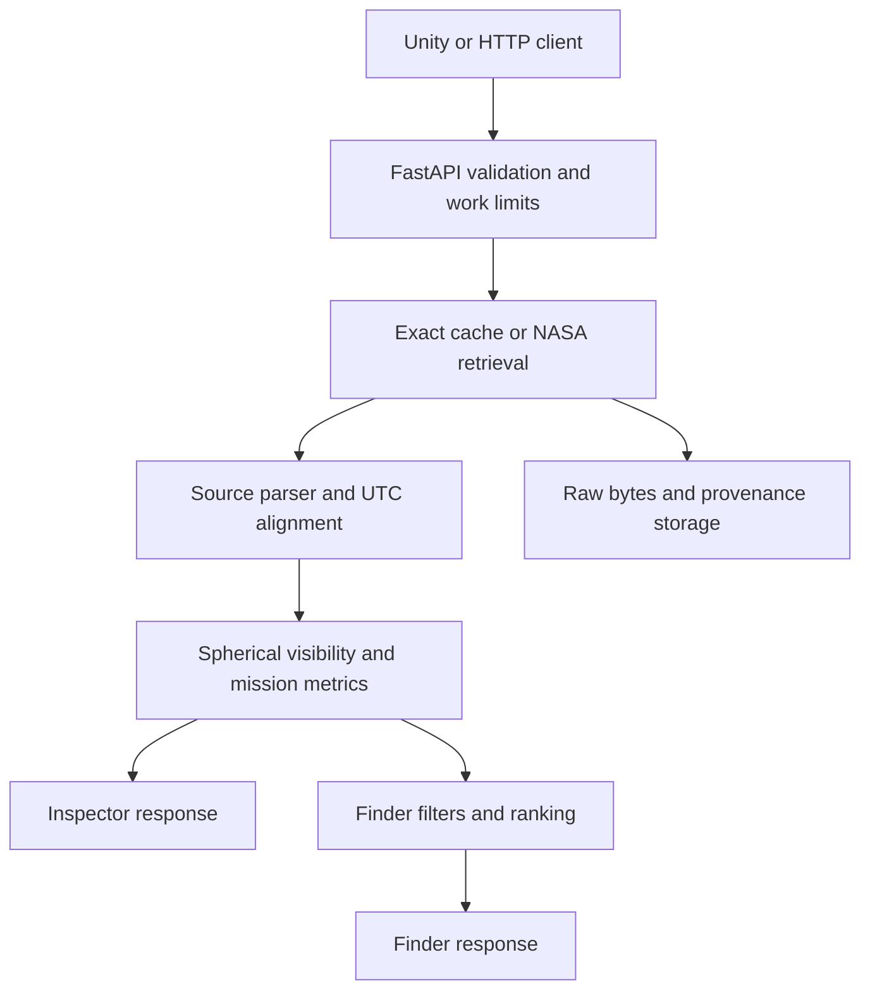

# LunarNavigator Scientific Backend Reference

**Validated release: GEOMETRIC_ONLY. Reference date: 15 November 2026.**

This document explains the implemented Python backend, its scientific model, operating limits, and retained validation evidence. It is intended for reviewers, integration teams, and maintainers. Source code is the behavioral authority. [backend/docs/API_CONTRACT.md](../backend/docs/API_CONTRACT.md) remains the exact HTTP integration contract; [docs/DATA_CONTRACT.md](DATA_CONTRACT.md) remains the separate legacy static-file contract. This reference changes neither contract.

The current service provides `GET /health`, `GET /sites`, `POST /analyze`, and `POST /opportunities`. It uses genuine NASA/JPL Horizons ephemerides and a spherical lunar horizon. **It does not calculate obstruction by lunar terrain or certify landing safety.**

## 1. Project scientific overview

Near the lunar south pole, the Sun and Earth can remain close to the local horizon. Mission planning therefore requires time-dependent estimates of illumination and direct-to-Earth visibility, rather than a single image or a fixed landing-date assumption.

LunarNavigator answers two bounded questions:

- **Site Inspector:** for one selected reference center or custom coordinate, landing UTC, and mission duration, what fractions of the mission have the Sun, Earth, or both above the modeled geometric horizon? How long are the longest interruptions, and when do sampled visibility states change?
- **Opportunity Finder:** within an editable arrival-date search interval, which sampled site-and-arrival combinations satisfy four mission constraints, and which rank highest under the selected policy?

Both features use the same ephemeris parser, horizon model, and mission metrics. Dates, coordinates, height, duration, and sampling cadence affect the actual NASA request and cache identity. The online service does not read a fixed December CSV to answer later requests.

Results support comparison under a common model. They cannot establish terrain illumination, usable solar power, an RF link budget, safe touchdown terrain, or operational landing approval. Every scientific response identifies its status as `GEOMETRIC_ONLY`.

## 2. Complete technology stack

### Runtime and numerical representation

The inspected project interpreter is **CPython 3.11.15, 64-bit AMD64, packaged by Anaconda**, in `backend/.venv`. The service is Python, served by Uvicorn through ASGI. FastAPI provides routing; Pydantic validates request objects; Starlette supplies underlying HTTP responses and application behavior. Synchronous calculation endpoints run through the framework's thread-pool support. The application/OpenAPI version is `1.0.0`; the scientific algorithm version is `0.1.0`; live response `schema_version` is integer 1. These identifiers describe different layers.

The calculation path uses Python `float` values, normally IEEE 754 binary64, and `math` functions. It does not round scientific values for display before returning JSON. Binary64 still has finite numerical precision; an apparent unit score can serialize as `0.9999999999999999`.

### Exact dependency pins and roles

The following is the complete pin set in [backend/requirements.txt](../backend/requirements.txt). Installed package metadata matched all 43 pins when this reference was checked. A package being installed does not mean the live calculation engine uses it directly.

| Package | Pinned version | Actual role |
| --- | --- | --- |
| affine | 3.0.1 | Rasterio raster-coordinate dependency; no terrain pipeline uses it in this release. |
| annotated-doc | 0.0.4 | FastAPI's annotated documentation support. |
| annotated-types | 0.7.0 | Pydantic constraint metadata. |
| anyio | 4.15.1 | Starlette asynchronous/thread-pool infrastructure and test support. |
| attrs | 26.1.0 | Installed dependency in the GIS/support environment. |
| certifi | 2026.10.23 | CA bundle for Requests/HTTPX; the production urllib client uses its default system/Python TLS configuration. |
| charset-normalizer | 3.5.2 | Requests text-encoding support. |
| click | 8.5.1 | Uvicorn and GIS command-line dependency. |
| click-plugins | 1.1.1.2 | Rasterio command-line support. |
| cligj | 0.7.2 | Common GIS command-line options. |
| colorama | 0.4.6 | Windows terminal color support. |
| contourpy | 1.3.3 | Matplotlib contour-rendering dependency. |
| cycler | 0.12.1 | Matplotlib plotting style cycles. |
| fastapi | 0.141.1 | `science/api.py`: routes, request handling, HTTP exceptions, and generated API documentation. |
| fonttools | 4.68.0 | Matplotlib font handling. |
| h11 | 0.16.0 | HTTP/1.1 protocol support for Uvicorn/HTTPX infrastructure. |
| httpcore | 1.0.9 | HTTPX transport dependency, chiefly API testing here. |
| httpx | 0.28.1 | FastAPI/Starlette TestClient transport in isolated API tests; not the production NASA client. |
| idna | 3.20 | Internationalized hostname support for HTTP libraries. |
| iniconfig | 2.3.1 | Pytest configuration support. |
| kiwisolver | 1.5.1 | Matplotlib layout constraints. |
| matplotlib | 3.11.2 | `science/evidence.py` and `science/inspect_site.py`: retained elevation and visibility PNG plots. |
| numpy | 2.4.6 | Installed scientific-array library and environment checks; the live visibility/metric path uses Python floats and sequences. |
| packaging | 26.3 | Package/version utilities used by installed tools. |
| pandas | 3.1.1 | Installed tabular-analysis capability; not required by the live parser or metric implementation. |
| pillow | 13.0.0 | Matplotlib image output dependency. |
| pluggy | 1.7.0 | Pytest plug-in infrastructure. |
| pydantic | 2.11.10 | `AnalyzeRequest` and `OpportunitiesRequest`: finite values, field constraints, and cross-field validation. |
| pydantic_core | 2.33.2 | Pydantic validation engine. |
| Pygments | 2.21.0 | Test/report syntax highlighting dependency. |
| pyparsing | 3.3.3 | Matplotlib expression/font parsing dependency. |
| pyproj | 3.7.2 | Installed geospatial transformation capability; no DEM transformation or terrain LOS is implemented. |
| pytest | 9.2.0 | Scientific, parser, cache, API, and retained-data tests under `backend/tests`. |
| python-dateutil | 4.0.0 | Date utilities for plotting/tabular dependencies; canonical API UTC parsing uses the standard library. |
| rasterio | 1.4.4 | Installed GeoTIFF/raster capability; not an implemented terrain-obstruction engine. |
| requests | 2.34.2 | Historical `horizons_probe.py` diagnostic HTTP client; not the current service's NASA transport. |
| scipy | 1.17.1 | Installed scientific-analysis capability; no SciPy interpolation or optimization is used by the current mission engine. |
| starlette | 0.52.1 | FastAPI's ASGI/HTTP foundation and TestClient support. |
| typing-inspection | 0.4.2 | Runtime typing inspection used by validation dependencies. |
| typing_extensions | 4.16.0 | Typing compatibility for framework dependencies. |
| tzdata | 2026.6 | Time-zone data for installed date/tabular packages; science timestamps are explicit UTC. |
| urllib3 | 2.8.0 | Requests transport dependency; separate from standard-library `urllib.request`. |
| uvicorn | 0.54.0 | ASGI server started with `science.api:app`. |

Important standard-library components are `datetime`/`timedelta`/`timezone` for UTC grids, `math` for geometry and finite-value checks, `dataclasses` for scientific records, `urllib.request`/`urllib.parse`/`urllib.error` for encoded HTTPS requests, `json` and `csv` for serialization, `hashlib` for SHA-256 integrity, `pathlib` for storage, `uuid` for run identifiers, `threading.BoundedSemaphore` for concurrency, and `time` for bounded transport retry delays. The live-proof scripts also use subprocess and local HTTP/process utilities to start and stop their own Uvicorn process.

### File formats

| Format | Use |
| --- | --- |
| JSON | HTTP requests/responses, catalog, original NASA API envelopes, cache manifests, and validation evidence. |
| Horizons response text | Original observer-table text inside the NASA JSON `result`, also retained as readable `.result.txt` files. |
| CSV | Parsed Sun/Earth tracks, aligned diagnostic ephemerides, and visibility flags. |
| PNG | Saved diagnostic elevation and visibility plots. |
| XML and text logs | JUnit test results and operational proof logs. |
| GeoTIFF | Relevant to possible LOLA raster inputs and installed Rasterio; not consumed by the current live scientific pipeline. |

## 3. Scientific data sources

### NASA/JPL Horizons

Horizons calculates observer ephemerides: apparent directions to a target as seen from a specified observer at specified times. The current backend uses the official [GET API](https://ssd.jpl.nasa.gov/api/horizons.api), with the [API documentation](https://ssd-api.jpl.nasa.gov/doc/horizons.html) and [Horizons manual](https://ssd.jpl.nasa.gov/horizons/manual.html) as scientific references. NASA also documents a [file-based POST interface](https://ssd-api.jpl.nasa.gov/doc/horizons_file.html); the implemented client uses GET.

The two targets are **Sun, ID 10**, and **Earth, ID 399**. The observer is a custom Moon-fixed location, `CENTER='coord@301'`, where 301 identifies the Moon. `COORD_TYPE='GEODETIC'` and `SITE_COORD='longitude,latitude,altitude'` specify degrees east, degrees north, and kilometers above the nominal reference surface. The API converts `observer_height_m` to kilometers. It does not add an unverified terrain elevation.

The parser requires the returned lunar sphere to have radii **1737.4 km** and a center-frame description containing `MEAN_ME (high precision)`. Catalog records separately retain their published `MOON_ME/DE421` source-product convention. The service does not perform a DEM datum transformation or demonstrate a site-specific frame-registration accuracy.

The exact query options constructed by `HorizonsRequest.params()` are:

| Option | Value / meaning |
| --- | --- |
| `format` | `json`, preserving the NASA envelope and `result` text. |
| `COMMAND` | Quoted target `10` or `399`. |
| `OBJ_DATA`, `MAKE_EPHEM`, `EPHEM_TYPE` | `NO`, `YES`, `OBSERVER`. |
| `CENTER`, `COORD_TYPE`, `SITE_COORD` | `coord@301`, `GEODETIC`, east-longitude/north-latitude/altitude-km. |
| `START_TIME`, `STOP_TIME` | Exact requested whole-second UTC start and final boundary, formatted for Horizons. |
| `STEP_SIZE` | Integer minutes, such as `10 m`. |
| `QUANTITIES` | `4`: apparent azimuth and elevation. |
| `APPARENT` | `AIRLESS`: no atmospheric-refraction correction. |
| `ANG_FORMAT`, `TIME_DIGITS` | `DEG`, `SECONDS`. |
| `TIME_TYPE`, `TIME_ZONE`, `CAL_FORMAT` | `UT`, `+00:00`, `CAL`. |
| `CSV_FORMAT`, `EXTRA_PREC` | `YES`, `YES`. |
| `ELEV_CUT`, `SKIP_DAYLT` | `-90`, `NO`, retaining below-horizon and daylight rows. |

These are apparent **target-center** angles, not upper-limb solar contact angles. Airless does not mean a geometric inertial direction stripped of all apparent-position effects: the backend uses the apparent coordinates supplied by Horizons without adding its own refraction model.

### Parsing and synchronization

`parse_response()` validates the JSON envelope and currently recognizes the observed signature `source='NASA/JPL Horizons API', version='1.2'`. Other signatures/versions fail validation; they are not silently accepted or relabeled. An HTTP 200 with a NASA `error` field is a failure.

The parser checks the target ID/name, lunar center, user-defined observer, airless convention, frame, sphere radii, echoed coordinates/height, requested start/stop, and cadence. Coordinate echo tolerance is `5e-7` in the corresponding degree or kilometer unit; longitude comparison allows equivalent wrapped source notation. All required values must be finite.

Exactly one `$$SOE` and one later `$$EOE` must delimit the table. Columns are found by unique headings, specifically `Date__(UT)__HR:MN:SS`, `Azimuth_(a-app)`, and `Elevation_(a-app)`. Empty CSV flag columns are preserved; the parser does not guess numeric positions. Source timestamps use a fixed English month mapping. It accepts minute/second forms and zero-valued fractional seconds, but rejects nonzero fractional seconds.

Each timestamp must equal the requested start plus its row index times the cadence. Row count must equal the endpoint-inclusive expected count. Duplicate, missing, shifted, reversed, nonfinite, or malformed rows fail. Elevation must be within [-90, 90] degrees; azimuth must be within [0, 360] on input, with 360 normalized to 0. Validated tracks therefore use [0, 360).

`align_tracks()` requires matching Sun/Earth request identities apart from target, identical timestamps, and identical counts. It never takes a smaller intersection to conceal missing rows. `AlignedTracks` validates the resulting regular UTC grid again.

### Provenance and retention

Raw response bytes are saved before scientific parsing. Attempt receipts record request identity/URL, retrieval time, HTTP status/headers or genuine error, and SHA-256. Successful source text, cache manifests, and per-run request/response JSON are retained. Cache hits also produce receipts and are explicitly identified in response provenance.

A checksum detects changed bytes; it is not independent proof of physical accuracy or a cryptographic NASA signature. Source headers preserve ephemeris, time/EOP, and coordinate assumptions needed to interpret a retrieval. Future-time results depend on Horizons' then-current predictions and known leap-second assumptions.

### NASA LOLA: separate source, separate capability

The [Lunar Orbiter Laser Altimeter (LOLA)](https://lola.gsfc.nasa.gov/) measures lunar topography from laser ranging. Gridded elevations and derived products can support terrain horizon reconstruction. Relevant official resources include [PDS LOLA products](https://pds-geosciences.wustl.edu/missions/lro/lola.htm) and [NASA Goddard's PGDA south-pole products](https://pgda.gsfc.nasa.gov/data/LOLA_5mpp/).

The current release does **not** acquire or validate a DEM, establish actual ground height, ray-trace crater walls, or create a terrain skyline from LOLA. Rasterio and PyProj installation, a source-cited site catalog, and a 360-value horizon array do not establish those capabilities. The returned horizon array is the same spherical threshold in every azimuth bin.

## 4. Lunar site catalog

The catalog is [backend/data/sites.json](../backend/data/sites.json). All coordinates below are retained exactly as tabulated in NASA **M2M-30044, Lunar Surface Data Book, Baseline, 18 March 2025, Table A2.1-1**: [official PDF, page link](https://ntrs.nasa.gov/api/citations/20250002845/downloads/M2M-30044%20Lunar%20Surface%20Data%20Book%20Baseline_Final.pdf#page=75).

| Stable ID | Display name | Latitude, degrees north | Longitude, degrees east | Source point |
| --- | --- | ---: | ---: | --- |
| `shackleton_rim` | Shackleton Rim (Site04 reference center) | -89.7668 | -171.87 | R04/Site04 polygon center. |
| `connecting_ridge` | Connecting Ridge (Site01 reference center) | -89.4632 | -137.49 | R01/Site01 polygon center. |
| `malapert_mountain` | Malapert Massif (Site23 reference center) | -85.9948 | -0.23578 | R23/Site23 polygon center; not a certified summit observation point. |

The recorded source frame is `MOON_ME/DE421 (PGDA source products)`, associated with the linked PGDA products. Latitude is north positive, longitude east positive in [-180, 180]. Negative longitude means west of the prime meridian. Verification covers coordinate citation only: **these are reference centers, not certified touchdown points, verified ground elevations, or terrain-safety assessments.**

`GET /sites` returns only verified supported records, sorted by stable ID. Each includes `verified`, `point_source`, `coordinate_frame`, `coordinate_convention`, `reference_description`, and `verification_scope` in addition to name and coordinates. Catalog loading rejects duplicate/unsupported IDs and incomplete verified records.

Site Inspector also accepts explicit custom coordinates without a DEM. They remain `CUSTOM_UNVERIFIED_DIAGNOSTIC_POINT`, with an empty response `site.id`. Named sites are labeled `VERIFIED_CATALOG_POINT_NOMINAL_SPHERE_OBSERVER`. Neither status verifies actual ground. Finder accepts catalog IDs only. Exactly polar coordinates are rejected; |latitude| >=89.95 degrees produces a library warning but is preserved if still strictly inside (-90, 90).

The diagnostic coordinate **(-89.5 degrees latitude, 0 degrees east)** is not a catalog site or a landing recommendation. Unity selection markers must use `GET /sites` values rather than independent approximations.

## 5. Mathematical methodology

### Coordinates, azimuth, and elevation

Let A be azimuth in degrees, clockwise from local north: north=0, east=90, south=180, west=270. Let e be elevation in degrees above the local horizontal plane. A direction in a local east-north-up (ENU) frame is interpreted as

\[
\mathbf{u}_{ENU}=(\cos e\sin A,\ \cos e\cos A,\ \sin e).
\]

Trigonometric inputs in this expression must first be converted to radians. Conversely, for a direction with components (u_E,u_N,u_U), elevation is atan2(u_U, sqrt(u_E²+u_N²)) and azimuth is atan2(u_E,u_N), wrapped to [0, 360) degrees. These equations explain angle interpretation and rendering. The backend receives A and e from Horizons; it does not implement a separate inertial-to-ENU ephemeris transformation. Unity must map ENU to its chosen scene axes.

### Observer height and spherical horizon

Let R=1,737,400 m be the nominal lunar sphere radius and h be observer height in meters above that sphere. A ray tangent to the sphere has elevation threshold

\[
H(h)=-\frac{180}{\pi}\arccos\!\left(\frac{R}{R+h}\right)\quad\text{degrees}.
\]

At h=0, H=0 degrees. At the approved default **h=2 m**, H is **-0.08693657193373108 degrees** (approximately -0.086936572 degrees). The negative threshold is horizon dip: an elevated observer can see slightly below the horizontal plane. The same h sets both the Horizons observer altitude and the spherical threshold.

`Horizon('spherical_dip', h)` implements this model. `Horizon('tangent_plane', h)` is a separate tested library convention with threshold zero regardless of h; online endpoints always select `spherical_dip`. The height is not 2 m above measured local lunar ground. No refraction, mountain, crater wall, or terrain correction is added.

### Visibility rules

At sample i, let e_S,i and e_E,i be Sun and Earth center elevations. Define indicator I(condition)=1 when true and 0 otherwise:

\[
S_i=I(e_{S,i}>H+\mu_S),\qquad E_i=I(e_{E,i}>H),\qquad B_i=S_iE_i.
\]

The library supports a Sun margin mu_S in degrees; the online API fixes it to **0.0**. Equality with the threshold is hidden. A visible limb when the center is hidden does not count as visible. Azimuth is returned for interpretation/rendering, but does not affect the constant spherical horizon classification.

### Mission cells and visibility fractions

Let t_i=t_0+i*delta_t be n regular UTC boundary instants, with delta_t in seconds. Sample i is held constant on **[t_i, t_(i+1))**. Thus n instants define **n-1 complete cells**. The last boundary supplies coverage and a state, not another duration cell.

For a mission [L, L+D), define a=(L-t_0)/delta_t and m=(3600*D)/delta_t, where D is hours. Both must be integers, a>=0, m>0, and **a+m<=n-1**. Otherwise the library rejects the mission. It does not truncate or silently snap boundaries.

\[
f_{sun}=\frac{1}{m}\sum_{i=a}^{a+m-1}S_i,\quad
f_{earth}=\frac{1}{m}\sum_{i=a}^{a+m-1}E_i,\quad
f_{both}=\frac{1}{m}\sum_{i=a}^{a+m-1}B_i.
\]

These are dimensionless time fractions because cells have equal duration. Percentages for display are 100 times these values. For example, 73 hourly boundaries cover exactly 72 hours, not 73.

### Continuous outages, intervals, and events

Let r_S be the longest consecutive run of zero Sun flags inside the mission, and r_E the corresponding Earth run. Then

\[
dark\_max\_h=r_S\,\frac{\delta_t}{3600},\qquad
comm\_gap\_max\_h=r_E\,\frac{\delta_t}{3600}.
\]

Outages touching mission edges are clipped to the requested mission. If always visible, the outage is zero; if always hidden, it is D. Visible intervals are maximal consecutive visible cells, clipped to [L,L+D), with exclusive end timestamps.

`visibility_changes` records changes strictly inside the mission; a change exactly at its end contributes no duration and is excluded. `events` reports next loss/recovery for Sun, Earth, and both, beginning at landing and searching through the last acquired boundary. Its states are `ALREADY_HIDDEN`, `ALREADY_VISIBLE`, `FUTURE_LOSS`, `FUTURE_RECOVERY`, and `NONE_WITHIN_COVERAGE`. Already states refer to landing, not the next opposite transition. A future event contains its sampled UTC and the preceding/current sample pair in `crossing_bracket_utc`.

Events may extend beyond the mission if a larger series was acquired, as in Finder. `NONE_WITHIN_COVERAGE` means no event found in retained coverage, not permanent visibility. A transition at the terminal boundary can be reported as an event without adding a mission cell.

### Resolution and precision

No sub-cadence crossing interpolation is performed. A detected crossing is bracketed by adjacent samples; the reported state transition uses the later boundary. At hourly cadence this is an hourly bracket; at default cadence it is ten minutes. Left-held fractions and outages are discretized estimates. Multiple transitions within a cell can be missed, so cadence is not a universal error bound on total visible time. Fine floating-point precision does not remove temporal or physical-model uncertainty.

The library also contains periodic skyline interpolation and an unknown-fraction-bounds helper. Neither constitutes a validated terrain model. The online routes require complete finite source data and do not return partial unknown-state timelines.

## 6. Site Inspector calculation pipeline

1. FastAPI validates `AnalyzeRequest`, including the exclusive choice of site ID or coordinates, exact UTC syntax, finite numeric ranges, mission/cadence compatibility, service dates, and instant count.
2. A named ID resolves to a verified catalog center; a custom coordinate receives its explicit diagnostic status. An analysis slot is reserved or HTTP 429 is returned.
3. A unique run directory records the validated request. Start is the exact landing UTC, end is start plus requested duration, and observer altitude is h/1000 km.
4. `calculate_response()` constructs one Sun query and one Earth query. For each, it uses an exact validated real cache entry or makes the matching HTTPS request. Targets are fetched sequentially.
5. Both sources are validated and synchronized. Any missing target, bad metadata, incomplete table, or mismatched timestamp fails the analysis rather than shortening it.
6. `AlignedTracks`, the spherical `Horizon`, `visibility_series()`, and `mission_metrics()` calculate the full requested interval using binary64 values and half-open cells.
7. The service saves and returns the live response, source provenance, limitations, angle/state series, and mission metrics. No static Unity release files are published.

The exact inputs and outputs are specified in Section 8. Model exceptions, network failures, busy slots, and storage failures have distinct handled error responses. `GET /health` alone does not demonstrate this pipeline or NASA connectivity.

### Genuine retained example

The accepted [request](../backend/docs/api-examples/analyze-request.json) selects `connecting_ridge`, lands **2027-02-15T06:00:00Z**, requests **24 hours**, uses h=2 m and a ten-minute cadence. Its complete [response](../backend/docs/api-examples/analyze-response.json) covers through **2027-02-16T06:00:00Z**, with **145 instants and 144 cells**.

| Metric | Actual result |
| --- | ---: |
| `f_sun` | 0.0 |
| `f_earth` | 1.0 |
| `f_both` | 0.0 |
| `dark_max_h` | 24.0 hours |
| `comm_gap_max_h` | 0.0 hours |
| `horizon_deg` | -0.08693657193373108 degrees |

These are geometric target-center results for a reference center, not terrain or operational predictions. The response retains the source window, request parameters, metadata, and raw-byte hash for each target.

## 7. Opportunity Finder algorithm

### Search and acquisition

Let L0 be `earliest_landing_utc`, W be `search_window_h`, D be `mission_duration_h`, and delta_L be `search_step_h`. W describes the arrival search range, not the duration of each mission. Candidate starts are

\[
L_j=L_0+j\,\delta_L,\qquad j\ge0,\quad j\,\delta_L<W.
\]

All three durations must be whole ephemeris-cell multiples. The number of arrivals per site is J=ceil(W/delta_L); W need not be a multiple of delta_L. A step larger than W yields one arrival. The arrival at exactly L0+W is excluded.

For each requested verified site, `calculate_finder()` obtains one Sun/Earth pair covering **L0 through L0+W+D**, inclusive of the final boundary. It deliberately requests this full covering window, even if the final sampled arrival needs slightly less coverage. The combined W+D must satisfy service limits. All requested sites must have valid complete pairs; missing data fails the request, not just that site's ranking.

The service then evaluates all overlapping missions [L_j,L_j+D) locally using `mission_metrics()`. It makes no NASA request inside the arrival loop. Normally there are at most two fresh target requests per site, or zero on exact cache hits; a corrupt-cache refresh is an exceptional additional attempt. `source_pair_count` counts site datasets, not fresh network calls.

### Hard constraints

All four filters apply before scoring; equality passes:

| Request field | Acceptance rule | Default |
| --- | --- | ---: |
| `min_sun_fraction` | f_sun >= requested minimum | 0.30 |
| `min_earth_fraction` | f_earth >= requested minimum | 0.40 |
| `max_dark_h` | dark_max_h <= requested maximum | 36 hours |
| `max_comm_gap_h` | comm_gap_max_h <= requested maximum | 48 hours |

These defaults are editable application presets, not NASA mission standards. There is no separate minimum simultaneous-visibility constraint in this schema; f_both contributes to ranking.

### Score, policies, and deterministic selection

For each passing scenario the exact implemented score is

\[
Q=0.4f_{sun}+0.3f_{earth}+0.2f_{both}
  +0.1\left(1-\min\left(1,\frac{dark\_max\_h}{D}\right)\right).
\]

Q is dimensionless and uses unrounded metrics. Earth outage affects the hard filter, but has no separate score term beyond Earth/joint fractions. The weights are application choices, not an optimized mission utility or a probability of success.

`BEST_OVERALL` sorts all qualifying scenarios by descending Q, then ascending canonical UTC, then ascending ordinal site ID. `EARLIEST_QUALIFYING` first restricts to the earliest qualifying sampled arrival and then applies the same ordering within that cohort. It does not add later arrivals to fill the list.

At most three distinct **(site_id, landing_utc)** pairs are returned, with ranks 1–3. The same site at different times can occupy multiple ranks. `evaluated_count`, `rejected_count`, and `qualifying_count` describe the entire evaluated set before top-three selection.

### Empty results and closest misses

No qualifying scenario is a successful HTTP 200 calculation with `recommendations=[]`, zero `qualifying_count`, and `empty_reason='No scenario satisfies all four hard constraints.'`. Up to five `closest_misses` are included, with actual metrics and all failed constraint names. They are not recommendations.

For a miss, its normalized violation is

\[
V=\max(0,s_{min}-f_{sun})+\max(0,e_{min}-f_{earth})
 +\frac{\max(0,dark\_max\_h-d_{max})}{D}
 +\frac{\max(0,comm\_gap\_max\_h-c_{max})}{D}.
\]

Here s_min/e_min are fraction minima and d_max/c_max are outage-hour maxima. Misses sort by number of failed constraints, V, arrival UTC, then site ID. Normalization uses positive D, not a possibly zero outage limit. Missing ephemerides produce an API error, never a closest miss.

### Worked example: illustrative arithmetic, not NASA observations

For two 24-hour scenarios, suppose A has (f_sun,f_earth,f_both,dark_max_h)=(0.4,0.5,0.4,12), while a later B has (1,1,1,0). If both pass the four hard filters, Q_A is approximately 0.44 and Q_B approximately 1.00. `BEST_OVERALL` ranks B first; `EARLIEST_QUALIFYING` selects A's earlier cohort. These invented values explain ranking only and are not astronomical evidence.

### Genuine retained search

The complete [real request](../backend/docs/api-examples/opportunities-request.json) searches 48 arrival hours beginning **2026-12-01T00:00:00Z**, with 24-hour missions, six-hour arrival spacing, all three sites, and ten-minute ephemerides. It evaluates 8 arrivals/site, **24 scenarios**, with **433 source instants/site** over the 72-hour covering period. The [real response](../backend/docs/api-examples/opportunities-response.json) has 18 rejected and 6 qualifying scenarios, returning three Malapert Massif arrivals at December 1 00:00, 06:00, and 12:00 UTC. Each returned scenario has f_sun=f_earth=f_both=1, darkness/outage=0, and serialized score `0.9999999999999999`.

Finder searches a sampled grid, not continuous arrival time. A qualifying arrival between search steps can be missed, and a returned best scenario is best only among the evaluated combinations under this model and score.

## 8. FastAPI service — exact contract

The base development URL is `http://127.0.0.1:8000`. JSON field names below are case-sensitive. Unknown POST fields are rejected. Scientific numeric inputs must be finite JSON numbers, not booleans or numeric strings; integer-only cadence rejects fractions. The HTTP reference and full real JSON fixtures are linked below. The request OpenAPI schema is also available at `/openapi.json`, with interactive documentation at `/docs` and `/redoc`.

### GET /health

No parameters or request body. HTTP 200 means the local service is responsive. This is the exact retained response:

```json
{
  "status": "ok",
  "api_profile": "lunar-analyze-v1",
  "data_status": "GEOMETRIC_ONLY",
  "service_start_utc": "2018-01-01T00:00:00Z",
  "service_stop_utc": "2030-01-01T00:00:00Z",
  "max_mission_duration_h": 744,
  "max_instants": 10001,
  "nasa_connectivity": "not probed by health endpoint"
}
```

The date fields are support boundaries, not process start/stop times. This route makes no NASA request and reserves no analysis slot.

### GET /sites

No parameters or request body. HTTP 200 contains:

| Field | Type and meaning |
| --- | --- |
| `schema_version` | Integer 1. |
| `api_profile` | String `lunar-sites-v1`. |
| `data_status` | String `GEOMETRIC_ONLY`. |
| `sites` | Array sorted by ID, containing the three records in Section 4. |
| `limitations` | String stating reference-center and ground/terrain/touchdown limitations. |

Each record has exactly: `id`, `name`, `point_source`, `coordinate_frame`, `coordinate_convention`, `reference_description`, and `verification_scope` (strings); `lat_deg` and `lon_east_deg` (numbers); and `verified` (boolean). See the complete [real sites response](../backend/docs/api-examples/sites-response.json). This route does not acquire ephemerides.

### POST /analyze: input

| Field | Type | Required/default | Validation and units |
| --- | --- | --- | --- |
| `site_id` | String or null | One location form required | 1–64 characters, verified catalog ID; mutually exclusive with any explicit coordinate. |
| `latitude_deg` | Number or null | Both coordinates if no ID | Strictly -90 < latitude < 90, north positive. |
| `longitude_deg` | Number or null | Both coordinates if no ID | -180 <= longitude <= 180, east positive; no silent normalization. |
| `landing_utc` | String | Required | Exact canonical UTC with seconds and Z. |
| `mission_duration_h` | Number | Required | >0 and <=744 hours; exact whole sampling cells. |
| `observer_height_m` | Number | 2.0 | Inclusive [0,1000] m above nominal sphere. |
| `sampling_step_minutes` | Integer | 10 | Inclusive [1,60] minutes. |

The complete interval and endpoint-inclusive row count must also pass Section 9. The following is an actual accepted request, not a synthetic result:

```json
{
  "site_id": "connecting_ridge",
  "landing_utc": "2027-02-15T06:00:00Z",
  "mission_duration_h": 24.0,
  "sampling_step_minutes": 10,
  "observer_height_m": 2.0
}
```

### POST /analyze: successful response

The complete real [145-instant response](../backend/docs/api-examples/analyze-response.json) is the representative machine-readable example. Its metrics are summarized in Section 6; arrays are not abbreviated into a misleading partial JSON response here.

| Object | Exact fields and types |
| --- | --- |
| Root | `schema_version` integer=1; `api_profile` string=`lunar-analyze-v1`; `data_status` string=`GEOMETRIC_ONLY`; `algorithm_version` string=`0.1.0`; `run_id`, `generated_utc` strings; objects `site`, `request`, `ephemeris`, `terrain`, `visibility`, `metrics`, `provenance`; `limitations` string array. |
| `site` | `id` string (empty for custom); `lat_deg`, `lon_east_deg`, `observer_height_m` numbers; `coordinate_status` string. |
| `request` | `landing_utc`, `mission_end_utc` UTC strings; `mission_duration_h` number; `sampling_step_minutes` integer. |
| `ephemeris` | `source`, `t0_utc` strings; `step_s`, `n`, `complete_cells` integers; `utc` string array; `sun_az_deg`, `sun_el_deg`, `earth_az_deg`, `earth_el_deg` number arrays. All arrays have n entries; `complete_cells=n-1`. |
| `terrain` | `source` string=`none; nominal 1737400 m sphere`; `az_step_deg` number=1.0; `horizon_el_deg` array of 360 identical numeric thresholds; `incomplete_sectors` empty array. The field name is a compatibility shape, not evidence of terrain analysis. |
| `visibility` | `sun_margin_deg` number=0.0; `sun_visible`, `earth_visible`, `both_visible` arrays of n integer 0/1 states; `horizon_convention` string=`spherical_dip`; `horizon_deg` number. |
| `metrics` | Numbers `f_sun`, `f_earth`, `f_both`, `duration_h`, `horizon_deg`, `sun_margin_deg`, `dark_max_h`, `comm_gap_max_h`; strings `start_utc`, `end_utc`, `horizon_convention`, `event_scope`, `time_model`; integers `cells`, `step_s`; `events` object; arrays `sun_visible_intervals`, `earth_visible_intervals`, `both_visible_intervals`, `visibility_changes`. |
| Each visible interval | `start_utc`, `end_utc` strings; end exclusive. |
| Each visibility change | `utc` string; `sun_visible`, `earth_visible`, `both_visible` integers. |
| `metrics.events` | `sun`, `earth`, `both` objects, each with `next_loss` and `next_recovery`. |
| Each event | `status` string; `utc` UTC string or null. Future loss/recovery additionally has `crossing_bracket_utc`, a two-UTC-string array. Status meanings are in Section 5. |
| `provenance` | `sun` and `earth` objects, defined below. |
| Each source provenance | `target_id` integer; strings `cache_key`, `raw_sha256`, `raw_cache_file`, `retrieved_utc`, `source_start_utc`, `source_end_utc`; `cache_hit` boolean; `source_n` integer; `request_parameters` and `metadata` maps of strings to strings. |

`raw_cache_file` is relative to the server cache root, not a public download URL. Angle units are degrees; cadence is seconds/minutes as named; duration/outages are hours; fractions are [0,1]. Timestamps are UTC. Visibility arrays include the terminal boundary; duration metrics do not assign it an extra cell.

### POST /opportunities: input

| Field | Type | Required/default | Validation and meaning |
| --- | --- | --- | --- |
| `earliest_landing_utc` | String | Required | Exact canonical UTC start of arrival search. |
| `search_window_h` | Number | Required | >0 and <=744 hours, half-open arrival span. |
| `mission_duration_h` | Number | Required | >0 and <=744 hours per candidate. |
| `candidate_site_ids` | String array | Required | 1–3 distinct verified catalog IDs; custom coordinates not accepted here. |
| `min_sun_fraction` | Number | 0.30 | Inclusive [0,1]. |
| `min_earth_fraction` | Number | 0.40 | Inclusive [0,1]. |
| `max_dark_h` | Number | 36 | Inclusive [0,744] hours. |
| `max_comm_gap_h` | Number | 48 | Inclusive [0,744] hours. |
| `search_step_h` | Number | 6.0 | >0 and <=744 hours between evaluated arrivals. |
| `ranking_policy` | String | `BEST_OVERALL` | Only `BEST_OVERALL` or `EARLIEST_QUALIFYING`. |
| `observer_height_m` | Number | 2.0 | Inclusive [0,1000] m above sphere. |
| `sampling_step_minutes` | Integer | 10 | Inclusive [1,60]. |

Search span, search step, and mission duration must each fit whole sampling cells. The combined covering interval and scenario count must pass Section 9. This is the actual accepted real search request:

```json
{
  "earliest_landing_utc": "2026-12-01T00:00:00Z",
  "search_window_h": 48.0,
  "mission_duration_h": 24.0,
  "candidate_site_ids": ["connecting_ridge", "malapert_mountain", "shackleton_rim"],
  "min_sun_fraction": 0.3,
  "min_earth_fraction": 0.4,
  "max_dark_h": 36.0,
  "max_comm_gap_h": 48.0,
  "search_step_h": 6.0,
  "ranking_policy": "BEST_OVERALL",
  "sampling_step_minutes": 10,
  "observer_height_m": 2.0
}
```

### POST /opportunities: successful and empty responses

The full [real qualifying response](../backend/docs/api-examples/opportunities-response.json) and [real empty response](../backend/docs/api-examples/empty-opportunities-response.json) retain complete metrics and provenance. The latter uses [this request](../backend/docs/api-examples/empty-opportunities-request.json), restricted to Connecting Ridge and Shackleton Rim, and evaluates 16 scenarios: 16 rejected, zero qualifying, and `recommendations=[]`. Its exact `empty_reason` is `No scenario satisfies all four hard constraints.` It still includes sources and closest misses.

| Object | Exact fields and types |
| --- | --- |
| Root | `schema_version` integer=1; `api_profile` string=`lunar-opportunities-v1`; `data_status` string=`GEOMETRIC_ONLY`; `run_id` string; `request` object containing all validated fields/defaults; `candidate_sites` string array; `sources` object array; `arrival_count_per_site`, `source_pair_count` integers; `score_formula`, `constraints_note` strings; `limitations` string array; `recommendations`, `closest_misses` object arrays; `evaluated_count`, `rejected_count`, `qualifying_count` integers; `empty_reason` string or null. |
| Each source | `site_id`, `coverage_start_utc`, `coverage_end_utc` strings; `n` integer; `provenance` with Sun/Earth source objects as above. |
| Each recommendation | `rank` integer 1–3; `site_id`, `site_name`, `landing_utc`, `mission_end_utc` strings; `mission_duration_h` number; `metrics` object with the exact Inspector metrics schema; `score` number; `explanation` string. |
| Each closest miss | `site_id`, `site_name`, `landing_utc`, `mission_end_utc` strings; `mission_duration_h` number; `metrics` as above; `failed_constraints` string array; `normalized_violation` number. No qualifying rank/score. |

Finder does not return full angle arrays per recommendation. Select a recommendation and call `/analyze` with that exact site/time/duration to obtain the visualized series. That narrower exact window may require its own NASA retrieval because the current cache does not slice a larger cached interval.

### Errors

Handled errors use `{"detail":{"code":"...","message":"..."}}`. Upstream-source errors additionally include `run_id` and `synthetic_fallback=false` inside `detail`.

| HTTP | Code | Cause |
| --- | --- | --- |
| 422 | `invalid_request` | Pydantic field/cross-field failure: extra fields, date/coordinate/range errors, nonfinite values, incompatible cadence, or excessive requested work. |
| 422 | `unknown_site`, `unverified_site` | Catalog identity/verification failure; no NASA acquisition for an invalid site list. |
| 422 | `unsupported_request` | Lower-level scientific query rejection, including an unsupported leap-insertion interval. |
| 429 | `busy` | Both shared analysis slots are occupied. |
| 503 | `horizons_unavailable` | Recognized transport/timeout/transient upstream failures with no usable exact cache. |
| 502 | `invalid_horizons_data` | Invalid signature, metadata, source table, pairing, or other rejected source response. |
| 500 | `storage_error` | Handled evidence/cache filesystem failure. |

The upstream classifier recognizes error messages containing `URLError`, `TimeoutError`, `HTTP 429`, or `HTTP 50` as unavailable; other `SourceError` cases map to 502. This is not a promise of a complete classification of every external failure. Unexpected unhandled exceptions can still produce framework 500 responses. No handled scientific failure substitutes synthetic ephemerides or an unrelated earlier result.

### Unity integration mapping

| Consumer feature | Required source and interpretation |
| --- | --- |
| Site selection/markers | Use `/sites` IDs, exact coordinates, names, and verification scope. |
| Dynamic Inspector | Submit current location/time/duration; bind the returned `site` and `request`, not the previous selection. |
| Sun/Earth directions | Use `ephemeris.utc`, `t0_utc`, `step_s`, `n`, and four degree arrays. Map the ENU expression in Section 5 to scene axes. Keep doubles until rendering conversion. |
| Metric display | `metrics.f_sun/f_earth/f_both` are fractions; `dark_max_h/comm_gap_max_h` are hours. |
| Mission timeline | Use authoritative visibility flags and interval/event objects. n boundaries mean n-1 cells; never extend the final state for an additional cadence. |
| Finder | Preserve returned ranking, landing UTC, full mission duration, and explanations; display closest misses separately. |
| Empty/error state | Show `empty_reason` for a successful empty search; show `detail` for non-2xx errors. Do not display an old result as a successful new calculation. |
| Scientific badge | Display `data_status=GEOMETRIC_ONLY` and retain provenance/coordinate limitations. |

Live envelopes are not legacy `index.json`, static opportunities files, or nine-window `reference_metrics` sets. An explicit adapter maps corresponding ephemeris/terrain/visibility fields into visualization models and retains live metrics/provenance separately. This reference does not amend the older static contract's rounding or interval rules.

## 9. Operating limits — prominent quick reference

These limits are enforced by `AnalyzeRequest`, `OpportunitiesRequest`, and the scientific query/mission validators. They are service policy, not the full extent of Horizons' capabilities.

| Parameter | Exact implemented limit and boundary meaning |
| --- | --- |
| Landing years | 2018–2029, subject to the full interval fitting. Earliest start is inclusive `2018-01-01T00:00:00Z`. |
| Latest mission/covering end | Inclusive `2030-01-01T00:00:00Z`. A positive-duration mission cannot start at this final boundary. |
| Inspector duration | >0 and <=744 hours, inclusive maximum, additionally a whole-cell duration. |
| Finder search span plus mission | W+D <=744 hours inclusive; W>0 and D>0 individually. Both alone being <=744 is insufficient. |
| Cadence | Integer 1–60 minutes inclusive, default 10. |
| Ephemeris instants | <=10,001 per target, including both boundaries; <=10,000 complete cells. Applies to Finder's full covering series per site. |
| Finder scenarios | <=1,000 inclusive, calculated as number of sites times ceil(W/search_step_h). |
| Finder site count | 1–3 distinct supported verified IDs. |
| Finder arrival step | >0 and <=744 hours, additionally whole-cell aligned. |
| Coordinates | Latitude strictly (-90,90); longitude inclusive [-180,180] degrees east. |
| Observer height | Inclusive [0,1000] meters above nominal sphere; default 2.0. |
| Visibility minima | Inclusive [0,1]. |
| Outage maxima | Inclusive [0,744] hours. Zero is valid. |
| Concurrent calculations | Two shared `/analyze` or `/opportunities` requests per application instance/process; additional concurrent requests receive 429. |

**Combination rules matter.** At one-minute cadence, the row cap limits a request to 10,000 minutes, about 166.667 hours, even though 744 hours is the duration ceiling. A 720-hour Finder search with a 48-hour mission fails the combined cap. A three-site search may fail the 1,000-scenario cap even when its covering interval fits. A mission shorter than one cadence or not an exact cadence multiple fails rather than rounding.

UTC input must be exactly `YYYY-MM-DDTHH:MM:SSZ`, with a valid calendar date and time. Date-only strings, timezone offsets such as `+00:00`, fractional seconds, and leap-second `:60` syntax are rejected. Landing time need not align to a global ten-minute clock: a start at 06:13:25 is preserved, and its grid starts there. Duration/cell checks use exact binary floating-point whole-second/modulo tests, without a rounding tolerance; clients should construct exact cell-multiple durations.

The lower-level request model rejects known leap-insertion crossings. The public range starts after the last insertion in its recorded list, so this is chiefly a safeguard, not an assurance that unknown future leap/EOP changes are already incorporated.

There is no implemented per-IP/per-minute rate limiter, authentication, application-level request-body byte cap, or CORS middleware in this app. Work is bounded through validated scenarios/rows and two analysis slots; that semaphore is not a requests-per-second quota and is not shared across separate worker processes. Authentication, TLS termination, browser-origin policy, and deployment protection would require an appropriate hosting configuration.

NASA transport uses a **30-second timeout per urllib request operation**, not an end-to-end Finder deadline. The online path normally makes one attempt per target; the lower-level reusable fetcher defaults to two attempts when used directly. Sequential sites/targets and exceptional cache refreshes can make total request latency longer than 30 seconds. No separate whole-analysis timeout or cancellation contract is implemented.

## 10. Caching, performance, and reliability

The default storage root is `backend/data/api`, with `cache/` and `runs/` below it. `create_app(storage_root=...)` permits a different root programmatically, including isolated test storage; the current command-line service has no dedicated storage-root environment setting.

A cache key is SHA-256 of a canonical request identity: observer coordinates/height/frame/model/status, target, exact start/stop, cadence, endpoint, algorithm version, cache format, and full Horizons parameter map. Each identity directory has `current.json` plus content-addressed `<raw_sha256>.raw.json` source bytes. A cache hit verifies manifest identity, safe filename, checksum, and the full source parse again.

Changing site, coordinate, date, duration, height, or cadence prevents a mismatching entry from satisfying the request. Even a physically equivalent custom point and named center can have different identities because status is retained. Only an exact matching interval is reused; there is no current superset slicing, interpolation, or automatic chunk-download planner.

Bad cache data is rejected. The API can make one fresh acquisition after a cache-related `SourceError` when a manifest exists. Corrupt addressed bytes are quarantined, valid raw bytes are restored, and the manifest is replaced through a temporary file. Invalid source responses and transport errors are retained as attempt evidence but are not accepted as cache data.

**No TTL, periodic revalidation, expiration, eviction, or disk-retention policy is implemented.** Exact identity and byte validation prevent unrelated-date substitution, but they do not guarantee that a previously retrieved future prediction reflects the latest Horizons/EOP update. `retrieved_utc`, metadata, and cache-hit flags must remain visible. The reusable client has refresh/offline controls; the public POST schemas do not expose them.

TLS verification is not disabled. The urllib transport uses normal environment/system proxy behavior; genuine proxy, DNS, TLS, timeout, or upstream failures remain failures. The generic fetcher retries recognized transient HTTP 429/500/502/503/504 or OS/network errors if additional attempts are allowed, with a short `0.25*attempt` delay. It does not repeatedly retry invalid scientific content. The live API's normal `attempts=1` avoids extended retries.

Performance depends on source coverage/cadence, number of sites and arrivals, cache matches, disk I/O, and NASA response time. Finder retrieves per site, then evaluates overlapping windows locally, but does not use an indexed constant-time sliding-window optimizer: `mission_metrics()` builds visibility states from the supplied series for each scenario. Validated work caps bound this cost. No latency SLA or NASA availability guarantee is established.

If either target is missing and no exact valid cache exists, the service returns an error. It does not downgrade to a static CSV, interpolate missing data, or produce fabricated recommendations. Local storage must remain writable and have sufficient capacity to retain evidence.

## 11. Architecture and source-code map



Paths below are relative to the project root. Functions prefixed with an underscore are internal helpers; public reusable entry points are listed here.

| Path | Responsibility / key functions and classes | Dependencies and pipeline role |
| --- | --- | --- |
| `backend/science/models.py` | `Observer`, `HorizonsRequest`, `TrackRow`, `EphemerisTrack`, `parse_utc`, `utc_text`. | Standard-library records, coordinate/request constraints, UTC and NASA parameter identity. |
| `backend/science/horizons.py` | `fetch_track`, `parse_response`, `validate_rows`, `align_tracks`, `merge_rows`, `request_identity`, `cache_key`, `SourceError`. | Models, urllib, JSON, hashing, filesystem; source integrity, acquisition, cache, pairing. `merge_rows` validates shared chunk boundaries; live service does not automatically fetch chunks. |
| `backend/science/coordinates.py` | `spherical_horizon_deg`, `Horizon`. | Dataclasses/math; explicit sphere or tangent-plane threshold. |
| `backend/science/visibility.py` | `AlignedTracks`, `visibility_state`, `visibility_series`, `mission_metrics`; `periodic_horizon`, `unknown_fraction_bounds` helpers. | Models/coordinates/math only; no network, CLI, or file I/O. Shared science for Inspector/Finder. |
| `backend/science/sites.py` | `SiteRecord`, `load_catalog`, `supported_catalog`, `normalize_longitude`, `coordinate_mismatch`. | Models and catalog JSON; sourced coordinate verification and discrepancy checks. |
| `backend/data/sites.json` | Three cited reference-center records. | Runtime source for `/sites` and named requests. |
| `backend/science/api.py` | `AnalyzeRequest`, `coordinates`, `calculate_response`, `create_app`, module `app`. | FastAPI/Pydantic and science modules; service validation, acquisition orchestration, HTTP errors and evidence. |
| `backend/science/finder.py` | `OpportunitiesRequest`, `calculate_finder`. | API acquisition plus visibility, sites, ranking; one covering pair/site and local scenario enumeration. |
| `backend/science/opportunities.py` | `rank_opportunities`. | Pure filtering, scoring, deterministic top-three and closest misses; no HTTP/filesystem. |
| `backend/science/evidence.py` | `write_csv`, `write_pair`. | CSV/Matplotlib; reproducible diagnostic tables and elevation plot. |
| `backend/science/acquisition.py` | `diagnostic_queries`, `request_url`, `new_run`, `prepare_handoff`, `process_pair`. | Horizons/evidence; fixed diagnostic download/import workflow, separate from dynamic HTTP requests. |
| `backend/acquire_horizons.py` | Standalone Windows acquisition/import entry point. | Existing venv and acquisition helpers; retains genuine source bytes. |
| `backend/science/fetch_horizons.py` | Module CLI for explicit test coordinates, dates, cadence, refresh/offline acquisition. | Models/Horizons/evidence; supports reusable retrieval outside the HTTP service. |
| `backend/science/inspect_site.py` | `analyze_retained`, `main`. | Parses retained diagnostic pair; produces visibility CSV, internal analysis JSON, and PNG. Not a production fixed-date lookup. |
| `backend/live_api_proof.py` | Real local-server December/February acceptance workflow. | Starts Uvicorn, uses real HTTP, checks source bytes/windows and saves comparison evidence. |
| `backend/live_finder_proof.py` | Real `/sites`, `/analyze`, and Finder acceptance workflow. | Starts Uvicorn, retains results and validates source bytes/replayed recommendations. |
| `backend/horizons_probe.py`, `backend/src/horizons_probe.py` | Historical Horizons connectivity/probe code. | Requests and historical parsing; not imported as the live service client. |
| `backend/tests/` | Scientific, API, cache, and genuine retained-source regression tests. | Pytest/TestClient; mocked isolated transports are test-only. |
| `backend/docs/API_CONTRACT.md` | Frozen HTTP field/error reference and full fixture links. | Integration authority; separate from the shared legacy static-file contract. |

Runtime production imports do not load test fixtures or mocked providers. `calculate_response()` manages retrieval/storage; the visibility/metric functions remain independent of HTTP and files, making scientific behavior directly testable.

## 12. Installation, startup, and operation

### Windows environment

Use normal Windows PowerShell from the project root. The verified project environment already exists; do not replace it merely to run the service. The commands below use that interpreter explicitly, so shell activation is unnecessary. Installation requires package-index access; real proof scripts require NASA access.

```powershell
Set-Location -LiteralPath 'C:\Users\user\Documents\Unity\LunarNavigator'
& '.\backend\.venv\Scripts\python.exe' --version
& '.\backend\.venv\Scripts\python.exe' -m pip install -r '.\backend\requirements.txt'
```

For a clean workstation, provision a compatible 64-bit CPython environment first; the recorded working version is 3.11.15. Package pins are recorded in this reference, but a fresh installation on another machine is not itself part of the retained release proof.

### Start a persistent local service

Run this in a dedicated PowerShell window and leave it open. Ctrl+C stops the process.

```powershell
Set-Location -LiteralPath 'C:\Users\user\Documents\Unity\LunarNavigator'
& '.\backend\.venv\Scripts\python.exe' -m uvicorn science.api:app --app-dir backend --host 127.0.0.1 --port 8000
```

In another PowerShell window, check the local routes:

```powershell
Invoke-RestMethod -Uri 'http://127.0.0.1:8000/health'
Invoke-RestMethod -Uri 'http://127.0.0.1:8000/sites'
```

### Editable Inspector and Finder requests

The following input examples are valid schemas. Executing them performs real acquisition or exact-cache reuse; the code block itself is not a new claim of a NASA observation. `Invoke-WebRequest -OutFile` retains the response JSON without converting its scientific values through another serializer. Output filenames are overwritten when these commands are rerun.

```powershell
Set-Location -LiteralPath 'C:\Users\user\Documents\Unity\LunarNavigator'
$inspectorBody = @{
    site_id = 'connecting_ridge'
    landing_utc = '2027-02-15T06:00:00Z'
    mission_duration_h = 24
    observer_height_m = 2
    sampling_step_minutes = 10
} | ConvertTo-Json
Invoke-WebRequest -UseBasicParsing -Uri 'http://127.0.0.1:8000/analyze' -Method Post -ContentType 'application/json' -Body $inspectorBody -OutFile '.\backend\analyze-response.json'

$finderBody = @{
    earliest_landing_utc = '2026-12-01T00:00:00Z'
    search_window_h = 48
    mission_duration_h = 24
    candidate_site_ids = @('connecting_ridge', 'malapert_mountain', 'shackleton_rim')
    min_sun_fraction = 0.30
    min_earth_fraction = 0.40
    max_dark_h = 36
    max_comm_gap_h = 48
    search_step_h = 6
    ranking_policy = 'BEST_OVERALL'
    observer_height_m = 2
    sampling_step_minutes = 10
} | ConvertTo-Json
Invoke-WebRequest -UseBasicParsing -Uri 'http://127.0.0.1:8000/opportunities' -Method Post -ContentType 'application/json' -Body $finderBody -OutFile '.\backend\opportunities-response.json'
```

Change dates, durations, supported IDs, thresholds, and ranking policy as needed within the rules above. For a custom Inspector point, remove `site_id` and supply both `latitude_deg` and `longitude_deg`. Do not send both location forms.

### Automated tests and real NASA acceptance scripts

```powershell
Set-Location -LiteralPath 'C:\Users\user\Documents\Unity\LunarNavigator'
& '.\backend\.venv\Scripts\python.exe' -m pytest '.\backend\tests' -q
& '.\backend\.venv\Scripts\python.exe' '.\backend\live_api_proof.py'
& '.\backend\.venv\Scripts\python.exe' '.\backend\live_finder_proof.py' --landing-utc '2027-02-15T06:00:00Z' --search-utc '2026-12-01T00:00:00Z' --mission-hours 24 --window-hours 48
```

Each proof script starts its own real Uvicorn on an available localhost port, writes a unique `backend/data/runs/*-live-*` evidence directory, and stops its own server. The Inspector script compares genuine December/February windows. The Finder script saves all route responses and verifies retained target bytes and returned recommendations. A valid exact-cache hit is allowed and explicitly recorded; it is not claimed as a fresh HTTP download. `--health-only` does not establish scientific NASA acceptance.

### Local operation versus hosting

Binding `127.0.0.1` serves only the same computer. A Unity build on another device requires a reachable backend address and appropriate deployment/network configuration. This release evidence does not establish a publicly deployed cloud service. No cloud hosting, managed availability, public authentication, or TLS reverse proxy is provided by the local startup command.

Operational smoke checks are: health responds; sites match displayed coordinates; a new date changes the requested/source window; returned cell count fits the exact mission; Finder constraints and empty results are displayed honestly; and `GEOMETRIC_ONLY` remains visible. NASA failures must produce an error state rather than an unrelated old timeline.

## 13. Validation and test evidence

### Automated scientific/software coverage

The retained release run reports **156 passed, zero failures, zero errors, zero skips**, with 17.441 seconds recorded in the XML suite timing. See [JUnit XML](../backend/data/runs/release-20261115/tests.xml) and [test log](../backend/data/runs/release-20261115/tests.log). The text log reports 17.62 seconds total and one Starlette/AnyIO deprecation warning, not a scientific test failure. This count is the saved release result, not a new full-suite execution performed for this documentation.

| Test file(s) under `backend/tests/` | Verified behavior covered |
| --- | --- |
| `test_observer.py`, `test_sites.py` | Explicit sphere/height, invalid coordinates/poles, source/frame requirements, site duplicates, coordinate mismatch reporting. |
| `test_horizons_parser.py`, `test_time_series.py` | Named columns, metadata/signatures, boundaries, exact count/grid, UTC parsing, no missing-row intersection, chunk-boundary conflicts, leap safeguards. |
| `test_horizons_cache.py`, `test_acquisition_handoff.py` | Exact identity, offline misses, corrupt entries, real error retention, encoded URLs, safe source imports and reruns. |
| `test_visibility.py` | Hand-calculated cells, always-visible/hidden and alternating states, multiple blackouts, joint visibility, start/end boundaries, inadequate coverage, malformed values, precision, horizon convention and events. |
| `test_real_visibility.py`, `test_retained_horizons_proof.py` | Actual retained NASA bytes, pairing, physical angle ranges, CSV/output hashes, 24/72-hour geometric mission calculations. |
| `test_api.py` | 24/120-hour requests, dates/sites/durations/heights/cadences, no stale substitution, exact time of day, invalid inputs, meaningful errors, incomplete source rejection and corrupt-cache refresh. |
| `test_opportunities.py` | Multiple sites/dates/durations, bounded target calls, cache reuse, each hard filter, equality, deterministic ranking/policies, empty results, half-open last arrival and full mission coverage. |

Isolated transport tests use clearly synthetic fixtures or mocks to test failure and boundary cases. They are separate from real-source acceptance and are not runtime fallbacks.

### Retained genuine NASA milestones

| Evidence | Actual scope and locations |
| --- | --- |
| First diagnostic pair | `backend/data/runs/local-horizons-20261115T182625Z-4a08a2a5/`: 73 hourly Sun and 73 Earth instants, December 1–4, 2026 UTC, coordinate (-89.5,0), height 2 m. Contains `raw/sun.json`, `raw/earth.json`, source text, HTTP receipts, separate CSVs, `combined.csv`, `elevations.png`, and `validation.json`. |
| Real diagnostic visibility | `backend/data/runs/visibility-20261115/real-analysis-final/`: `analysis.json`, `visibility.csv`, `visibility.png`. At the diagnostic point, both 24/72-hour missions have f_sun=1, f_earth=f_both=0, darkness=0, Earth gap=24/72 hours respectively. |
| T029 real dynamic Inspector | `backend/data/runs/api-live-20261115T185938Z-4b822681/`: `comparison.json`, December and February request/response files, health and Uvicorn log. December 1–2, 2026: 24 hours, 145 ten-minute instants. February 15 at 06:00 through February 20 at 06:00, 2027: 120 hours, 721 instants. Source windows/cache identities/raw hashes distinguish the two genuine datasets. Additional review: `backend/data/runs/finder-20261115/T029-evidence.json`. |
| T032 real Finder | `backend/data/runs/finder-live-20261115T191921Z-75a49da9/proof.json`: PASS. Independent retained-source/candidate replay: `backend/data/runs/release-20261115/T032-evidence.json`. Three sites, six retained target envelopes, 433 instants per site, 24 scenarios, 18 rejected, 6 qualifying, 3 returned. Coordinates, complete mission windows, filters, ranking, hashes and GEOMETRIC_ONLY status were checked. |
| Frozen complete JSON examples | `backend/docs/api-examples/`: health/sites, Inspector request/response, qualifying Finder request/response, and empty Finder request/response. The empty case reuses exact genuine cached sources and rejects all 16 evaluated scenarios. |
| Release record | `backend/data/runs/release-20261115/release-freeze.json`, alongside the test and T032 review files. |
| Unity integration records | `docs/unity_real_fastapi_integration.txt`: 35 passed/0 failed for real HTTP, catalog values, February/December analysis and adapter behavior. `docs/unity_online_integration.txt`: 29 passed/0 failed for online payload/adapter/UI-state behavior; this second log includes fixture-based checks and is not a separate all-NASA proof. |

The source files, schemas, dependency pins, saved evidence and examples were inspected for this reference. Focused local checks validated all three inline JSON examples, valid/invalid request boundaries, local document links, all installed pins, and the horizon/score arithmetic. Six source pairs behind the frozen examples were reparsed and aligned, covering eight distinct retained NASA envelopes with matching SHA-256 hashes. Protected source/requirements and both existing contract files retained their original hashes. No network requests or broad test reruns were performed for these documentation checks.

These checks do not establish new live NASA availability, a clean installation on another machine, terrain-model validation, or universal correctness across all accepted inputs.

## 14. Scientific limitations and interpretation

- **Geometric versus terrain-aware:** the sphere accounts for curvature and observer height, not mountains, crater walls, slopes, or terrain shadows. A source above the spherical threshold may still be blocked in reality.
- **No validated LOLA obstruction model:** installed GIS libraries and cited mapped reference centers do not supply a local terrain skyline. Nominal sphere altitude is not verified lunar ground elevation.
- **Sampling:** classifications are left-held on regular cells. Contact times are cadence-limited and may miss short within-cell changes. Arrival-grid search can miss better starts between tested times.
- **Target center:** Sun/Earth centers are tested with a strict threshold. Solar disk partial visibility, penumbra, occulting terrain detail, and atmospheric effects are not modeled.
- **Earth visibility versus communications:** geometric direct-to-Earth visibility does not model a particular ground station, antenna pointing, Earth rotation at a receiver, RF power, data rate, interference, relay satellites, or link reliability.
- **Sun visibility versus power:** no solar-array orientation, efficiency, degradation, temperature, dust, energy storage, or electrical-load model is calculated.
- **Site meaning:** catalog verification is a coordinate-source check. Reference centers are not certified safe touchdown points; the Malapert entry is not a certified summit location. The diagnostic coordinate remains explicitly unverified.
- **Coordinates/frames:** catalog source conventions and Horizons source frame are retained, but no validated DEM registration or site-specific frame-error budget is provided.
- **Scope limits:** only three catalog centers are supported for Finder. Inspector accepts custom points inside its coordinate limits. Dates, durations, cadence, instant counts, and scenario counts are bounded as in Section 9.
- **Source availability/freshness:** operation needs accessible Horizons or a valid exact real cache. Future ephemerides inherit NASA's retrieval-time assumptions. Cache integrity alone does not ensure the latest prediction.
- **Ranking interpretation:** the score and default constraints express editable application preferences, not NASA safety criteria or certification. A top result is only a qualifying sampled scenario under this geometric model.
- **Release evidence:** passing software tests and retained real-source proofs support the documented implementation. They do not establish mission certification, measured surface accuracy, cloud uptime, or all possible operational conditions.

## 15. Glossary and official references

| Term | Meaning in this backend |
| --- | --- |
| Apparent direction | Target direction as supplied by the observer ephemeris, with its source conventions; not recomputed locally from Cartesian orbits. |
| Airless | No atmospheric-refraction correction. |
| Azimuth | Compass-like horizontal direction, clockwise from north, in degrees. |
| Elevation | Angle above the local horizontal plane, in degrees. |
| ENU | Local east, north, up coordinate axes. |
| Ephemeris | Predicted positions/directions indexed by time. |
| Geometric horizon dip | Negative horizon elevation caused by observing above a curved sphere. |
| GEOMETRIC_ONLY | Spherical-horizon calculation without validated terrain obstruction. |
| Observer height | Requested meters above the nominal lunar sphere, not measured local ground. |
| Cadence | Time between successive ephemeris boundary samples. |
| Half-open interval | Includes its start and excludes its end: [start,end). |
| Cell | Duration between two adjacent sample boundaries. |
| LOS | Line of sight; here the target center passes the nominal geometric horizon test. |
| DEM | Digital elevation model, a terrain-height dataset; not used in this validated release. |
| LOLA | Lunar Orbiter Laser Altimeter, a lunar topography instrument. |
| UTC | Coordinated Universal Time; API strings explicitly end in Z. |
| EOP | Earth-orientation parameters associated with source time/orientation assumptions. |
| Provenance | Source identity, request, retrieval metadata, raw files and integrity information. |
| SHA-256 | Hash used to detect byte changes and identify cache content. |
| ASGI | Python server/application interface used by FastAPI and Uvicorn. |
| Reference center | A source-tabulated regional/polygon center, not a certified touchdown location. |

Official scientific references:

1. [NASA/JPL Horizons API documentation](https://ssd-api.jpl.nasa.gov/doc/horizons.html).
2. [NASA/JPL Horizons user manual](https://ssd.jpl.nasa.gov/horizons/manual.html), including observer coordinates, observer quantities, time and apparent-position conventions.
3. [Horizons GET endpoint](https://ssd.jpl.nasa.gov/api/horizons.api).
4. [Horizons file-based POST documentation](https://ssd-api.jpl.nasa.gov/doc/horizons_file.html), documented alternative interface, not the implemented transport.
5. [NASA Lunar Surface Data Book, M2M-30044 Baseline](https://ntrs.nasa.gov/api/citations/20250002845/downloads/M2M-30044%20Lunar%20Surface%20Data%20Book%20Baseline_Final.pdf#page=75), Table A2.1-1 reference centers.
6. [NASA Goddard PGDA LOLA south-pole products](https://pgda.gsfc.nasa.gov/data/LOLA_5mpp/), catalog source-product frame association and mapped products.
7. [NASA LOLA instrument information](https://lola.gsfc.nasa.gov/) and [PDS LOLA data archive](https://pds-geosciences.wustl.edu/missions/lro/lola.htm).

Official software references: [Python](https://docs.python.org/3.11/), [FastAPI](https://fastapi.tiangolo.com/), [Pydantic](https://docs.pydantic.dev/), and [Uvicorn](https://www.uvicorn.org/). Package capabilities beyond the actual source paths described above are not claims of implemented LunarNavigator features.
