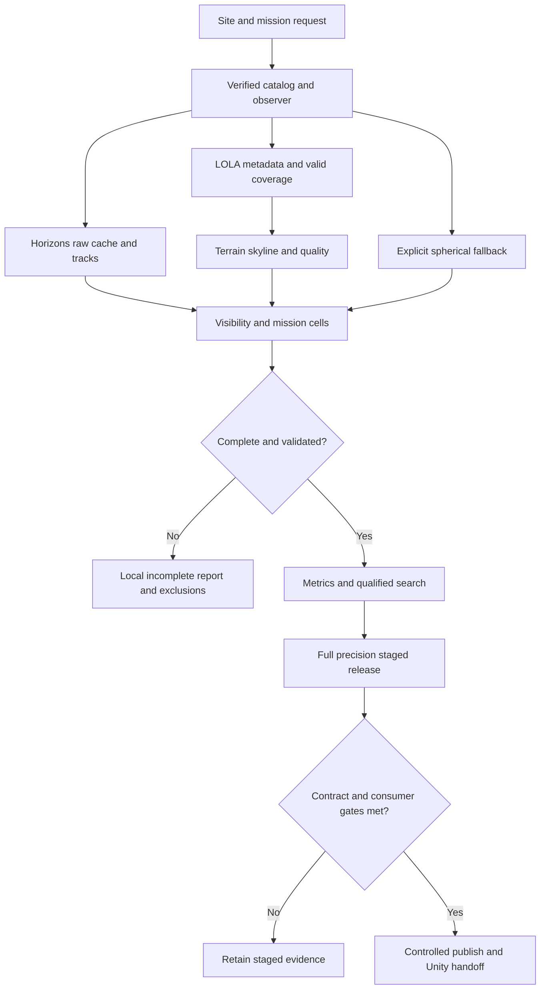

# Implementation Plan: Python Scientific Engine

**Branch**: `002-python-science-engine` (feature identifier only; no branch created or switched) | **Date**: 2026-11-15 | **Spec**: [spec.md](spec.md)

**Input**: Existing science specification, 30 clarification decisions, `backend/docs/1_PYTHON_SCIENCE_PLAN.md`, and the user's explicit approvals and revised delivery priorities. Planning only; Python implementation remains a separate reviewed stage.

## Summary

Build a small Python library with argparse commands that turns verified lunar observing points, retained JPL Horizons observations, and NASA LOLA rasters into tested visibility timelines, mission metrics and deterministic opportunity lists. Deliver useful single-site geometric science first; add validated terrain for that site before expanding to all three. Reuse the original S0–S11 science plan, correcting its approximate horizon, intermediate rounding, endpoint and incomplete-data assumptions with the approved clarification decisions. No FastAPI, ML, PINNs, database, new frontend, plugin framework or global optimizer.

Constitution **v1.1.0 was verified and applied** during this stage; [ratification evidence](governance-ratification.md) preserves I–X and existing Unity delivery/workflow. Full-precision scientific JSON and complete-only v1 are approved design decisions. The shared contract files are deliberately unchanged: [data-contract-amendments.md](data-contract-amendments.md) records exact text/application and consumer coordination needed **before implementation**, not another request for the approvals already given.

## Technical Context

**Language/Version**: CPython 3.12, 64-bit, project-local `backend/.venv`; use 3.11 only if 3.12 is unavailable and the baseline scientific wheels import successfully. Do not silently use the host's default newer Python. No environment is installed at planning time.

**Primary Dependencies**: requests, NumPy, pandas, matplotlib, pytest; rasterio and pyproj for terrain. SciPy is allowed by the baseline but deferred unless a concrete need appears; linear skyline interpolation needs no extra algorithm package. Standard library dataclasses, argparse, pathlib, csv, json, datetime, hashlib, logging and importlib.metadata. Use wheel-only binary installation for numerical/GIS packages; never compile GDAL under the deadline. Pin actual successful versions after smoke checks, record Python/OS/GDAL/PROJ versions, and retain a dependency manifest.

**Storage**: UTF-8 local files below backend/data: exact request/raw-response manifests and hashes, parsed tracks, DEM originals/crops/metadata, versioned skyline caches, run/evidence records and staged JSON releases. Large DEMs/venv/caches are excluded from source control using a backend-local ignore file; never change a root ignore or shared README without authorization.

**Testing**: pytest synthetic/hand-worked/contract tests plus explicitly marked retained-real-data and online-acquisition checks. Default unit tests need neither network nor multi-GB rasters. Integration skips remain NOT RUN in delivery evidence. Frontend parity is executed by the Unity owner, not this agent.

**Target Platform**: Windows desktop/PowerShell, scientific calculations outside Unity. Preserve existing Unity/HDRP/Input System configuration.

**Project Type**: Offline scientific library and command-line tools. All proposed command examples run from backend after implementation; none is executed now.

**Performance Goals**: One source pair and usable single-site output before generalization; baseline 4,465 rows/target/site; default Finder only 168 scenarios. Stream terrain in chunks of at most about two million pixels; target <1 GiB transient terrain working memory, measure peak memory/runtime on actual hardware and reduce chunk size when exceeded. Network time is reported separately. These are operational design targets, not measured performance claims.

**Constraints**: binary64 science/JSON, explicit source precision, half-open windows, complete-only v1 exchange, no fabricated input/status/PASS, no Unity edits, no partial schema. Prefer actual small/regional COG windows; no full raster >about 1.5 GB without selecting a smaller adequate product or reporting failure. Preserve finite-range/resolution uncertainty. Respect the user's stage review regardless of historical contest timeboxes.

**Scale/Scope**: First one verified site, ultimately three IDs; December 2026 baseline; 360 azimuth bins; 24/72/168 h Inspector windows; two Finder policies over finite supported sites. No unresolved architecture question remains. Exact sourced points, actual raster datum/footprints, accepted API headers and executed results are future verification gates, never guessed facts.

## Constitution Check

Gate evaluation before design and again after Phase 1:

| Principle / gate | Pre-design | Post-design | Evidence / enforcement |
| --- | --- | --- | --- |
| I; XI: truthful science/demo separation | PASS by design | PASS by design | Real-source gates; synthetic tests distinct; no production illustrative status. |
| II–IV, VI, VIII–X: preserve Unity governance | PASS | PASS | No Unity code/assets/settings/packages/scene/build changes; delivery order does not rewrite Unity work. |
| V: simple explicit responsibilities | PASS by design | PASS by design | Module table below, dataclasses and pure numerical functions; no unnecessary framework. |
| VII; XVI: executed evidence | PASS by design | PASS by design | Test matrix defines future checks; no runtime scientific check is marked PASS now. |
| IX: safe dependencies | PASS by design | PASS by design | Local evaluated Python wheels; no Unity packages/CLI/MCP updates. |
| XII–XIII: frames, time and precision | PASS by design | PASS by design | Observer/frame gates, explicit formulas and numerical budgets in algorithms/data model. |
| XIV: uncertainty | PASS by design | PASS by design | UNKNOWN internally; no incomplete site/uncertain opportunity exported as certified terrain science. |
| XV: full mission and honest ranking | PASS by design | PASS by design | All hard constraints before score; exact policies and empty/short lists. |
| XVII: ownership/validated exchange | PASS for planning | PASS with implementation gate | Shared pointer/contracts preserved; only approved constitution changed; contract wording/consumer acknowledgement precedes implementation. |

No constitutional exception is required. “PASS by design” verifies design compliance only, not source data, code, accuracy or performance. The exact approved constitution patch initially needed CRLF/LF-normalized context comparison; substantive preservation passed before mutation. See ratification record.

## Project Structure

### Documentation (this feature)

| Artifact | Purpose |
| --- | --- |
| plan.md | Architecture, dependencies, incremental order, gates and completion. |
| research.md | Phase 0 decisions, alternatives and official-source verification limits. |
| data-model.md | Scientific entities, identity, validity and state transitions. |
| algorithms.md | Exact geometry/time/metrics/search/cache/export algorithms. |
| contracts/cli.md | User-facing command inputs, outputs, errors and ownership. |
| contracts/unity-exchange.md | Approved-design v1 shapes, numerical parity and publication protocol. |
| data-contract-amendments.md | Exact approved wording to apply to the user-owned contract before implementation; no application in this stage. |
| test-matrix.md | Meaningful unit/real-data/parity/failure checks and tolerances. |
| quickstart.md | Future setup, staged execution and validation guide. |
| governance-ratification.md; workflow-record.md | Applied amendment verification and actual workflow/ownership evidence. |

No tasks.md or implementation source is created by Plan. Existing clarification/proposal artifacts remain traceable; the optional v2 proposal is historical/deferred and is not selected.

### Source Code (repository root; proposed, not created)

| Future backend path | Responsibility / dependency boundary |
| --- | --- |
| science/__init__.py | Algorithm version only. |
| science/models.py | Small typed dataclasses, enums and canonical request identities; NumPy arrays at numerical boundaries. |
| science/sites.py | Strict site catalog load/verification/normalization; does not trust asset labels as evidence. |
| science/horizons.py | Requests, envelope/header parsing, exact requests/raw cache; pandas track table and NumPy float64 conversion. |
| science/coordinates.py | Spherical ENU/Cartesian and verified product/source coordinate conversions; pyproj only for terrain projection. |
| science/terrain.py | Rasterio metadata/window/validity/ground sample handling. |
| science/horizon_profile.py | Original pixel-binning skyline, coverage evidence and sensitivity; NumPy, terrain, coordinates. |
| science/visibility.py | Pure periodic interpolation, knownness, intervals, mission metrics and transitions; no network/GIS. |
| science/opportunities.py | Hard filters, score, two deterministic policies and audit/exclusion reports; visibility only. |
| science/export_analysis.py | Full-precision staging, selected complete subset/index and controlled publication; never calculates celestial motion. |
| science/validate_contract.py | Independent structural/semantic reconstruction; no self-asserted validity based only on export functions. |
| science/evidence.py | PASS/FAIL/NOT RUN, source/dependency/run metadata, readable status/credits and plots. |
| science/fetch_horizons.py; inspect_site.py; acquire_dem.py; build_horizon.py | Thin argparse entry points over the preceding modules; no second implementation of math. opportunities/export_analysis/validate_contract also expose entry points. |
| tests/ | test_sites, test_horizons_parser/cache/time, test_coordinates, test_horizon, test_visibility, test_opportunities, test_contract, test_release and marked integration cases. |
| data/sites.json; data/cache/; data/dem/; data/runs/; data/staged/ | Catalog, raw/canonical caches, terrain, evidence and unpublished/released sets. |
| requirements.in; requirements.txt; pytest.ini; .gitignore; README.md | Backend-local environment/dependency capture, test markers, exclusions and regeneration guide. |

Existing `backend/horizons_probe.py` and duplicate `backend/src/horizons_probe.py` are inspected migration inputs. Their zero-altitude, positional numeric parsing and illustrative test coordinate are not a validated production pipeline. Preserve their provenance; use them as a request/reference fixture and replace their limitations in science/horizons.py rather than multiplying clients. No programming file was edited in this stage.

**Structure Decision**: Keep the original plan's science module paths under backend, add only small typed/shared helpers needed for numerical/data boundaries and evidence. Core geometry/metrics remain functions, not a service or inheritance framework. Avoid a standalone caching framework: canonical manifests and content hashes suffice.

## Architecture and data flow

Geometric and terrain scenarios have distinct observer/model/cache identities. A terrain observer with actual DEM ground height requires fresh or matching cached Horizons observations; an earlier nominal-height track cannot silently become terrain matched. Unknown inputs branch to a report, not to invented binary flags or a winning score.

## Incremental implementation order

The following is the exact dependency order for future tasks. Budgets are stop/reassess timeboxes adapted from the baseline, not elapsed measurements or promises. Preserve successful earlier deliverables when later gates fail.

| Order / priority | Baseline mapping | Work and timebox | Exit evidence / useful deliverable |
| --- | --- | --- | --- |
| 0 — prerequisite | S0 governance/contract | Before implementation, apply approved contract wording through its owner; obtain consumer acknowledgement of full precision/endpoints/complete subset. Ratification already applied. | Contract hash/version/profile recorded; no pending precision ambiguity. |
| 1 — P0 | S0 | Select Python 3.12/3.11, local venv, core wheels/import and binary64 smoke checks, pytest setup, dependency capture; ~15 min. Defer GIS install to terrain stage. | Reproducible core environment; no failed GIS setup blocks a useful geometric result. |
| 2 — P0 | S2 moved ahead of production S1 | Verify one exact observing point/source/frame; reject unverified placeholders; log current asset comparison; ~15 min. | One verified catalog site; other named entries explicitly unverified/unavailable. |
| 3 — P0 | S1/S3 | Implement/verify one real Sun/Earth proof, retain raw/header evidence, then full 31-day 600 s baseline and cache; ~10+40 min. | Real data for one verified site; physical/cadence/source checks and plot evidence. |
| 4 — P0 | S6/S7 early path | Pure visibility/metrics tests; exact sphere fallback at declared observer; strict JSON validator/staged single-site index; ~30+30 min. | Valid geometric-only JSON and nine reference windows for one site; useful offline Inspector before DEM. |
| 5 — P0 | S4 | Wheel-only rasterio/pyproj import, choose actual regional COG, inspect/crop/reopen and verify metadata/frame/datum/ground/control points; ~40 min, fallback at ~70. | Real usable terrain for the first site, or preserved geometric release plus honest failure. |
| 6 — P0 | S5 | Synthetic geometry/gap tests first, then chunked pixel-binned skyline/coverage/plots and height/range sensitivity; ~50 min. | Tested real profile with no relevant unknown support; otherwise incomplete local result, no terrain certification. |
| 7 — P0 | S6–S8 | Match actual observer/Horizons tracks; terrain timelines/full missions and sampled sensitivity; pre/post-export validation; ~30+25 min. | One terrain-aware complete scientific result or retained explicit fallback, with evidence. |
| 8 — P1 | S2/S3/S4–S8 expansion | Verify the other two exact points, repeat independent site/observer/coverage checks; reuse source products safely. | Up to three supported complete site analyses; exclusions and reasons for any missing site, no blanket all-three PASS. |
| 9 — P1 | S9 | Finite 14-day/6 h/72 h search, all constraints, deterministic policies/misses; ~50 min. | Up to three recommendations, zero allowed; eligible cohort and exclusions reported explicitly. |
| 10 — P1 integration; P0 evidence throughout | S10/S11 | Science method/credits/status are maintained after every passed step; hand off validated bytes and parity vectors to Unity owner. ~25 min docs, bounded repro support. | Backend regeneration guide, evidence table, dependency/source manifest, consumer double-parity acknowledgement; no Unity edits. |
| 11 — P2 | After useful result | Only then evaluate finer local DEMs, supported region expansion, optimization, better memory/runtime, transition refinement. | Measured benefit with validation; ML/FastAPI/PINNs remain out of scope. |

The latest user priority makes three-site expansion P1 rather than a prerequisite for the first release, and permits useful geometry despite terrain setup failure. These are explicit overrides of the original S0/S7 all-at-once/time-pressure instructions, not forgotten requirements. Full three-site/finder completion remains final feature scope.

## Failure, recovery and publication

Detailed failures/commands are in [contracts/cli.md](contracts/cli.md); algorithms/tests define the exact scientific boundaries. Network failure, unverified point, invalid source header, datum/CRS mismatch, bad observer ground or relevant missing skyline support cannot be “fixed” by replacing science values. Preserve raw evidence, mark the step FAIL/NOT RUN and either use an already validated cache or explicitly request the geometric model. Never patch terrain holes with geometric sky for certification.

A release with fewer sites is explicit: index and opportunity candidate_sites contain only the accepted complete cohort; original requested IDs and excluded reasons remain in science-owned run/status evidence and the handoff, never silently disappear. No schema-v2 masks/counters or partial-body timelines are emitted. Default strict `--all` can fail on exclusions; an explicit `--allow-exclusions` operation uses the user's approved known-subset behavior and must print/write the complete exclusion report.

Publication is per-file atomic, with staged semantic validation, explicit destination ownership, backup/rollback and index last. Fixed filenames cannot guarantee an atomic multi-file snapshot to a concurrent unmodified Unity reader. Require a consumer reload/startup barrier during commit and one deliberate reload afterward; if unavailable, keep the set staged. Do not pretend index-last alone solves concurrency. Versioned physical filenames or a future consumer snapshot protocol require separate coordinated contract design, not an unapproved fix here.

## Scientific acceptance and readiness

All 42 requirements and nine success criteria remain traceable through [test-matrix.md](test-matrix.md). Gates are incremental: real-source proof, complete single-site geometry, real terrain/observer equivalence, complete terrain metrics, expansion/finder, then consumer evidence. A URL, nominal resolution, passed projection round-trip, compilation or written plan never establishes validated terrain accuracy.

Readiness for `$speckit-checklist` and `$speckit-tasks`: **yes**, with the exact contract application/consumer acknowledgement as the first implementation prerequisite. No unresolved design choice prevents task decomposition. Do not start Python implementation in this stage, do not create tasks.md here, and do not re-request the owner approvals already granted. Scientific runtime results remain NOT RUN.

## Complexity Tracking

No constitutional violation or exception. Deferred alternatives: service layer, plugin/repository abstraction, ML surrogate, arbitrary global search, SPICE replacement route, partial v2 interchange, and fine-resolution DEM optimization before a validated baseline. Their absence keeps the plan executable under the deadline.
