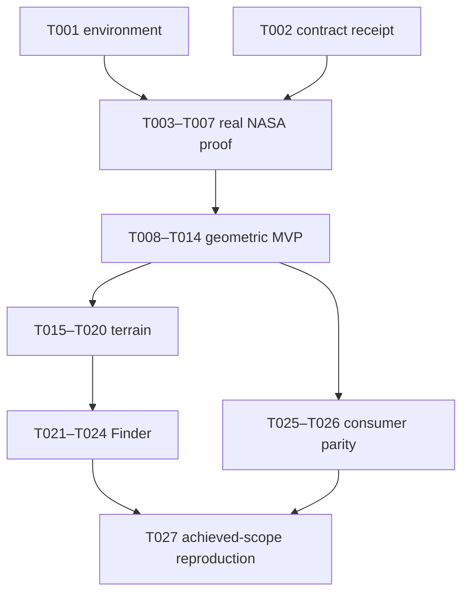

# Tasks: Python Scientific Engine

**Date**: 2026-11-15. **Feature**: `specs/002-python-science-engine`.
**Inputs**: [spec](spec.md), [clarifications](clarifications.md), [plan](plan.md), [algorithms](algorithms.md), [test matrix](test-matrix.md), [contract amendments](data-contract-amendments.md), [data model](data-model.md), [CLI](contracts/cli.md), [Unity exchange](contracts/unity-exchange.md), [quickstart](quickstart.md), and original backend/docs/1_PYTHON_SCIENCE_PLAN.md S0–S11.
**State**: 27 pending tasks; none executed by generating this file. Existing planning and constitution ratification are complete and are not duplicated as tasks.

## Format and execution rules

Task checkboxes are `T001…T027`; test-matrix IDs such as T01/R01 are separate identifiers. [US1] means verified-site Inspector/real tracks; [US2] terrain; [US3] Finder; [US4] validated export/integration. User P0/P1 delivery priorities govern order. US4 is split into an early export slice and later consumer slice so first usable JSON does not wait for terrain/Finder.

All future paths are relative to `C:\Users\user\Documents\Unity\LunarNavigator`. Commands below run from backend using its `.venv\Scripts\python.exe` (abbreviated **PY**). Every task inherits these constraints:

- **Ownership O1**: write only listed backend/science-owned files and task-local evidence. No Unity C#, assets, stubs, .meta, Packages, ProjectSettings, existing Unity specification, root README, shared contract, branch or shared feature-pointer edits. Tasks T014/T020/T024/T026 may publish only explicitly owned non-stub science JSON after all release gates; otherwise keep staged.
- **Evidence E1**: each task records command/inputs/output paths, PASS/FAIL/NOT RUN and source/dependency/run identity in `backend/data/runs/<run_id>/Tnnn-evidence.json`. Angle brackets denote actual selected run/site values, not fabricated files. The coordinator serializes append-only science rows in docs/validation_report.md and docs/science_status.md; parallel workers never concurrently edit these shared ledgers. Preserve raw failures; skipped real tests are NOT RUN.
- **Completion C1**: checkbox completion requires stated executed verification and retained evidence; merely writing code or a URL is insufficient. Tests explicitly required by the spec are written/run first, with failure demonstrated for the missing/wrong behavior before implementation, then rerun. Synthetic fixtures stay labeled synthetic.
- **Fallback F1**: never invent values, coordinates, file names, URLs or PASS. Preserve the last validated result; stop only the affected branch and state why. No tolerance relaxation, partial v2 interchange, ML/FastAPI or new architecture. Human display rounding never feeds scientific calculations.

Every task below states its own files, inputs, outputs, verification, completion and fallback; O1/E1/C1/F1 also apply to each. [P] denotes distinct files that can be worked independently **after the listed prerequisites**, not authorization to spawn agents or overwrite another worker's files.

## Phase 1 — Setup: P0-A (S0)

- [X] T001 Establish the scientific environment and verify migrated probes in `backend/.venv/`, `backend/requirements.in`, `backend/requirements.txt`, `backend/pytest.ini`, `backend/.gitignore` and `backend/data/runs/<run_id>/environment.json`.
  - **Inputs/deps**: approved plan; available interpreter inventory; no task dependency. Read both backend/horizons_probe.py and backend/src/horizons_probe.py without treating them as validated.
  - **Outputs**: 64-bit Python 3.12 venv (3.11 only as validated fallback); requests/numpy/pandas/matplotlib/pytest imports; actual version lock and binary64/platform manifest; local cache/venv ignores and test markers.
  - **Verify/done**: run venv interpreter version/import/float64 smoke checks and record exact interpreter; confirm both probes readable and syntax-compilable without executing their default illustrative coordinate. Do not equate an empty pytest suite with functionality.
  - **Failure/ownership**: if interpreter/wheels fail, record the error and supported fallback, no silent host-version switch or GDAL compilation. GIS installs wait for T015; no probe/root ignore/shared file edits (O1).

## Phase 2 — Foundation and external compatibility gate (S0/S2)

- [ ] T002 [P] Record contract application and Unity-consumer compatibility in `backend/data/runs/<run_id>/contract-receipt.json`.
  - **Inputs/deps**: current user-owned docs/DATA_CONTRACT.md, migrated copy, approved feature data-contract-amendments.md and user-relayed Gemini acknowledgement. Independent of T001; user already approved numerical/complete-only choices.
  - **Outputs**: actual applied contract hash/profile and receipt for typed object arrays, binary64 JSON/double math, n−1 cells, accepted complete cohorts/exclusions and release reload coordination.
  - **Verify/done**: compare actual canonical text/hash with approved changes; record whether migrated reference is deliberately synchronized; verify receipt identifies consumer/profile and does not merely assert notification equals parity.
  - **Failure/ownership**: if absent/inconsistent, mark BLOCKED with exact required application/consumer action; never modify either contract or C# yourself. Preserve the plan's production-implementation/export gate; T001/read-only source verification can proceed. No repeat request to approve already-approved scientific decisions.

- [ ] T003 Create minimal catalog/request models and verify the first exact observing point in `backend/science/__init__.py`, `backend/science/models.py`, `backend/science/sites.py`, `backend/data/sites.json`, `backend/tests/test_sites.py`, and `docs/site_coordinate_check.md`.
  - **Inputs/deps**: T001 and T002 before production module implementation; official point citations, actual read-only Unity site assets. No assumed coordinate or zero asset height.
  - **Outputs**: typed identities/quality states, algorithm version, one cited verified south-pole observing point/frame; other two IDs explicitly unverified until sourced. Catalog tests cover test-matrix T01–T02.
  - **Verify/done**: `PY -m pytest tests/test_sites.py`; point citation reviewed; longitude normalization and exact/near-pole behavior tested; report any >0.05-degree asset mismatch.
  - **Failure/ownership**: cannot verify point => leave verified=false and exclude from production; a separately labeled test point may test connectivity but cannot complete the verified-site milestone. Do not move/update Unity markers (O1).

## Phase 3 — US1: first real NASA data and geometric Inspector (P0-B/P0-C; S1/S3/S6)

**Goal**: authentic, retained Sun/Earth tracks and useful standalone mission calculations.
**Independent test**: one verified site, matched observer, real paired baseline, inspected elevation plot and hand-checked mission metrics without Unity/terrain.

- [X] T004 [P] [US1] Add source parser/cache/time rejection fixtures in `backend/tests/test_horizons_parser.py`, `backend/tests/test_horizons_cache.py`, `backend/tests/test_time_series.py`, and `backend/tests/fixtures/horizons/`.
  - **Inputs/deps**: T003 models, official API/manual, existing probe as reference; test-matrix T03–T08. Mark simulated responses synthetic; use an observed header fixture from T006 when available.
  - **Outputs**: tests for blank flags/named headings, error envelopes/version/markers/n.a., wrong observer/target, cache identity changes, missing times, duplicate conflicts and pairing.
  - **Verify/done**: run selected pytest files and demonstrate that malformed inputs fail/reject for the intended reason; after T005 all tests pass. Do not invent a “real response” fixture.
  - **Failure/ownership**: unsupported actual heading is captured for a documented alias, never positional extraction or weaker checks. These tests can run alongside T008/T010 after shared models stabilize; separate files (O1).

- [X] T005 [US1] Implement corrected Horizons request, parser and cache commands in `backend/science/horizons.py` and `backend/science/fetch_horizons.py`.
  - **Inputs/deps**: T003–T004; requests-based baseline and approved request/observer/time conventions.
  - **Outputs**: real-request path, signature/error/header validation, UTC float64 tracks, parameter/observer-hashed raw caches, bounded retries, refresh and equal-boundary deduplication; no guessed altitude/header column positions.
  - **Verify/done**: `PY -m pytest tests/test_horizons_parser.py tests/test_horizons_cache.py tests/test_time_series.py`; changes in coordinates/height/frame/time/target invalidate cache; offline hit sends no request.
  - **Failure/ownership**: retain raw error/response and clear diagnostic, no fabricated ephemeris or undocumented host switch. No Unity or scientific exchange writes (O1).

- [ ] T006 [US1] Execute the first actual Sun/Earth query and plot its real elevations in `backend/data/cache/horizons/`, `backend/data/runs/<run_id>/source-proof/`, `backend/science/evidence.py`, and `docs/img/tracks_<site_id>_proof.png`.
  - **Inputs/deps**: T005; T003 verified point and explicitly declared geometric observer. First use a three-day, ten-minute proof span; a reused probe must not hide its zero-altitude limitations.
  - **Outputs**: genuine original Sun and Earth envelopes/result text, exact requests/headers/hashes, parsed CSV, actual elevation-versus-UTC PNG, S1-columns/source-proof evidence and source credits.
  - **Verify/done**: execute fetch CLI for both targets; inspect header mapping and first/last rows, expect 433 instants for a three-day endpoint-inclusive span; inspect the generated image and describe actual behavior. No intersection of mismatched time rows.
  - **Failure/ownership**: network/service/parameter failure is FAIL with retained response; correct against actual official docs then rerun. A cached genuine response may prove offline parsing but cannot be claimed as a newly executed live request. No demo substitution (O1/E1).

- [ ] T007 [US1] Acquire and validate the full one-site baseline in `backend/data/cache/horizons/`, `backend/tests/test_horizons_sanity.py`, `backend/data/runs/<run_id>/baseline/`, and `docs/img/tracks_<site_id>.png`.
  - **Inputs/deps**: T006 successful proof, same verified point/observer; 2026-12-01T00:00:00Z through 2027-01-01T00:00:00Z at 600 s.
  - **Outputs**: 4465 paired unique instants/4464 cells; real-cache physical checks, inspected plot, independent matched first/middle/last source comparison and offline repeat evidence.
  - **Verify/done**: run real-data sanity/time tests; exact endpoints/cadence/count; original Sun/Earth bounds and near-pole sweep when applicable; all finite; source-precision comparison per test matrix. Missing-cache skip is NOT RUN.
  - **Failure/ownership**: do not relax physical limits; investigate parse/frame/source settings. Preserve the three-day proof but do not claim it supports nine month-baseline reference windows (O1).

- [X] T008 [P] [US1] Add independent geometry/mission fixtures in `backend/tests/test_visibility.py` and `backend/tests/test_observer.py`.
  - **Inputs/deps**: T003 stable models and approved mathematics; independent of network/T006–T007 and T004 files.
  - **Outputs**: strict equality/margin/wrap/unknown tests, six-cells/hour, ten-cell S=1100111011/E=1010110011 oracle (.7/.6/.5, 1/3 h gaps), window edges/overflow/next-loss and exact sphere dip.
  - **Verify/done**: demonstrate missing/wrong implementation fails; after T009 `PY -m pytest tests/test_visibility.py tests/test_observer.py` passes; fractions 1e-12, hours 1e-9, analytic dip 1e-8 degree.
  - **Failure/ownership**: fix science rather than round to expectations; no real-data accuracy claim from synthetic PASS (O1).

- [ ] T009 [US1] Implement geometric observer, timelines and Inspector metrics in `backend/science/coordinates.py`, `backend/science/visibility.py`, and `backend/science/inspect_site.py`.
  - **Inputs/deps**: T008 tests; T007 required for actual baseline validation. Use declared R=1737400 m,h=2 m nominal model when actual ground is unknown.
  - **Outputs**: H=−acos(R/(R+h))≈−0.086936572 degrees; strict periodic visibility, explicit UNKNOWN/bounds locally, intervals, five metrics, distinct next-loss states and comparison support.
  - **Verify/done**: T008 tests pass; execute one 72 h Inspector and a second date for comparison; reject off-grid/out-of-coverage requests; preserve 4465/4464 and a+m<=n−1.
  - **Failure/ownership**: no hidden clamping, zero-plane/−0.05-degree substitution, or actual-ground claim for the nominal observer. Missing essential observations prevent a scientific result (O1).

## Phase 4 — US4 early slice: valid geometric JSON (P0-C; S7/S8)

**Goal**: usable one-site validated output without waiting for terrain/Finder.
**Independent test**: independently reconstruct staged full-precision JSON and reject corrupted copies without Unity.

- [ ] T010 [P] [US4] Write independent exchange/precision rejection tests in `backend/tests/test_contract.py` and `backend/tests/fixtures/contract/`.
  - **Inputs/deps**: T003 stable identities and T002 approved applied profile; test-matrix T25–T27. Can be authored independently of Horizons/terrain implementation.
  - **Outputs**: malformed type/version/length/flag/finite/duplicate-key/reference tests; 1/3/high-precision coordinate roundtrip and wrong visibility/metrics/score fixtures, synthetic and clearly labeled.
  - **Verify/done**: demonstrate rejection failures before T011, then pass all fixtures with readable diagnostic/exit assertions; no NaN/Infinity accepted.
  - **Failure/ownership**: do not fix consumer mismatch by independently changing shared schema or rounding science (O1).

- [ ] T011 [US4] Implement standalone independent contract reconstruction in `backend/science/validate_contract.py`.
  - **Inputs/deps**: T010; exact approved profile and independent reference formulas, not exporter self-certification.
  - **Outputs**: site/index/opportunity structural and semantic validator, strict JSON decoding, safe references, cell-aware metrics and known-cohort ordering/count checks. Direct root-script and module CLIs supported.
  - **Verify/done**: `PY -m pytest tests/test_contract.py`; every corrupted rule category rejects; exact masks/counts, fractions/score 1e-12, hours 1e-9; boundary samples separately audited.
  - **Failure/ownership**: nonzero exit plus specific field/index; do not repair input JSON or hide errors. Validator is read-only to exchange inputs (O1).

- [ ] T012 [US4] Implement full-precision complete-set staging in `backend/science/export_analysis.py` and `backend/data/staged/<run_id>/`.
  - **Inputs/deps**: T002 receipt, T007/T009 verified baseline/metrics, T011 validator.
  - **Outputs**: one GEOMETRIC_ONLY site JSON, index and nine reference windows (24/72/168 h at Dec 1/8/15 UTC), source/observer/algorithm provenance; no default publication.
  - **Verify/done**: scientific checks before serialization and independent validator over actual reread staged bytes after serialization; binary64 roundtrip, finite UTF-8/no BOM, all references valid and no partial masks.
  - **Failure/ownership**: relevant unknown => withhold that dataset, report reason and retain local analysis. No shared contract edits; data remains under backend unless release gates pass (O1).

- [ ] T013 [US4] Test and implement controlled release/rollback in `backend/tests/test_release.py` and the publication path of `backend/science/export_analysis.py`.
  - **Inputs/deps**: T012 staged sets; use temporary backend/test directories as destinations for failure injection, not Unity assets.
  - **Outputs**: destination ownership/path checks, verified-stage hashes, reader barrier receipt, backups, atomic per-file replacement/index last and rollback; refusal without gates.
  - **Verify/done**: `PY -m pytest tests/test_release.py`; ownership/conflict/interruption tests retain a consistent previous validated set; no false multi-file atomicity promise.
  - **Failure/ownership**: no barrier or another process owns index/data => leave staged; never delete another process's files, touch stubs/.meta or invent consumer acknowledgement (O1).

- [ ] T014 [US4] Validate and hand off the first geometric-only release in `backend/data/runs/<run_id>/geometric-release.json` and, only when permitted, `Assets/StreamingAssets/analysis/<site_id>.json` and `Assets/StreamingAssets/analysis/index.json`.
  - **Inputs/deps**: T012–T013 and T002; actual ownership/reload barrier for publication.
  - **Outputs**: passed independent real site/index validation, exact file/hash/status list, accepted site and explicit excluded IDs/reasons, evidence rows and user-facing science status.
  - **Verify/done**: validate the actual staged set, execute controlled publish only if all gates met, compare committed hashes; otherwise report VALIDATED/STAGED, not PUBLISHED, and retain useful files.
  - **Failure/ownership**: preserve previous release and raw evidence. Only explicitly owned non-stub scientific JSON destinations permitted; no Unity code/settings (O1).

## Phase 5 — US2: real LOLA and terrain-aware missions (P0-D/P0-E; S4–S8)

**Goal**: one honest terrain-aware result with validated observer/geometry and no relevant unknown support.
**Independent test**: analytic synthetic skyline checks plus actual acquired terrain metadata/control points/profile and complete mission calculations, independent of Unity/Finder.

- [ ] T015 [US2] Add GIS dependencies and the product inspection/acquisition interface in `backend/science/terrain.py`, `backend/science/acquire_dem.py`, `backend/requirements.in`, and `backend/requirements.txt`.
  - **Inputs/deps**: T001; approved terrain design. Core geometric work need not wait for this task.
  - **Outputs**: imported rasterio/pyproj wheels, actual GDAL/PROJ versions, commands to read actual listed COG/local products, retain metadata and persisted crops.
  - **Verify/done**: venv import and metadata-reader smoke tests on a synthetic georeferenced raster; record versions and binary64; no filesystem operations outside owned backend paths.
  - **Failure/ownership**: no GDAL compilation; hold terrain branch and keep geometric deliverable. Product URLs must come from an actual source listing (O1).

- [ ] T016 [US2] Retrieve and inspect an actual LOLA product in `backend/data/dem/`, `backend/data/runs/<run_id>/dem-metadata.json`, and `docs/sources_and_credits.md`.
  - **Inputs/deps**: T015 and T003 exact site; inspect research starter LDEM_80S_80MPP_ADJ.TIF from its actual official link, then verify acquired content.
  - **Outputs**: real source/crop identity/hash, CRS/frame/datum/radius/scale/units/registration/resolution/bounds/NoData/quality metadata, valid ground support and independent control-point evidence.
  - **Verify/done**: open/crop/reopen actual data; verify site and needed range support, mapping controls and height meaning; satisfy R04/R05. A page's filename is not acquisition validation.
  - **Failure/ownership**: outside coverage/mapping or unknown datum/ground => terrain unavailable; no moving site/zero height substitution. Prefer small adequate product; retain geometry if no usable DEM within original ~70 min fallback (O1).

- [ ] T017 [P] [US2] Add independent coordinate/terrain horizon tests in `backend/tests/test_coordinates.py` and `backend/tests/test_horizon.py`.
  - **Inputs/deps**: T003 models/T015 GIS environment; synthetic fixtures do not depend on actual DEM T016.
  - **Outputs**: sphere/tangent, north/east wall, raised observer, missing wedge/wrap, near-field/far gaps, bad registration/height/datum/transform tests (test-matrix T09–T15).
  - **Verify/done**: tests fail on wrong/missing implementations; later pass exact dip 1e-8 degree, sampled sphere .02 degree, approximate wall .15 degree and stated round-trip tolerances.
  - **Failure/ownership**: independent oracle cannot reuse the same production projection/maths as its sole expected result; gaps never silently become zeros (O1).

- [ ] T018 [US2] Implement frame-matched pixel-binned skyline and coverage in `backend/science/coordinates.py`, `backend/science/terrain.py`, `backend/science/horizon_profile.py`, and `backend/science/build_horizon.py`.
  - **Inputs/deps**: T017 failing fixtures; approved algorithms; T016 needed only for real-data use.
  - **Outputs**: valid bilinear ground, common-frame Cartesian ENU, chunked circular-range maxima, 360 bins, conservative angular-footprint missingness/near-field/range flags, cache identity and separate plotting fills.
  - **Verify/done**: selected pytest tests pass; no double curvature or intermediate rounding; projection/observer matching and zero-crossing support verified; inspect measured memory and reduce chunk size if needed.
  - **Failure/ownership**: any unbounded relevant missing support stays UNKNOWN; invalid ground/frame invalidates that pairing, never substitute a neighboring skyline (O1).

- [ ] T019 [US2] Execute real skyline validation and sensitivity in `backend/data/cache/skyline/`, `backend/data/runs/<run_id>/terrain-validation/`, and `docs/img/skyline_<site_id>.png`.
  - **Inputs/deps**: T016/T018; distinct sourced interior/rim controls where applicable, actual metadata and first site.
  - **Outputs**: inspected real skyline with incomplete sectors, source/control/frame checks, heights .5/2/10 m and ranges75/150 km comparisons, executed evidence.
  - **Verify/done**: execute build_horizon and real tests/plot inspection; all required per-site checks pass; document finite range, effective resolution/interpolation and unquantified uncertainty.
  - **Failure/ownership**: no terrain certification for failed/unrun checks or relevant unknown sectors; keep incomplete results local and retain geometric release (O1).

- [ ] T020 [US2] Produce validated terrain-aware missions and a complete release in `backend/data/runs/<run_id>/terrain-analysis/`, `backend/data/staged/<run_id>/`, and only gated owned `Assets/StreamingAssets/analysis/<site_id>.json`/`index.json`.
  - **Inputs/deps**: T019 passed checks, T009/T011–T014 reusable math/validation/release and T002 compatibility.
  - **Outputs**: Sun/Earth tracks fetched/reused for the actual ground-plus-mast observer, known terrain windows/five metrics, nine reference windows, 72 h 10-/30-minute sensitivity and actual TERRAIN_AWARE_ESTIMATE file only if eligible.
  - **Verify/done**: independently compare source/DEM observer/frame, run visibility/contract tests and actual serialized reconstruction; reader-gated handoff verifies bytes/status.
  - **Failure/ownership**: no nominal-height cache reuse as real observer, terrain/flat splice or UNKNOWN v1 flags. Withhold incomplete file, keep prior validated geometry and report reason (O1).

## Phase 6 — US3: three-site opportunity search (P1; S2 expansion/S9)

**Goal**: deterministic known mission qualifiers, not a guarantee of landing safety or a global optimum.
**Independent test**: synthetic metrics prove filters/policies/ties/empty states, then actual eligible data proves full missions and honest exclusions.

- [ ] T021 [US3] Verify and analyze the remaining catalog sites in `backend/data/sites.json`, `docs/site_coordinate_check.md`, and site-specific `backend/data/runs/<run_id>/`/`backend/data/staged/<run_id>/` outputs.
  - **Inputs/deps**: first validated pipeline T020 (or explicitly selected complete geometric cohort), actual sources for other exact points.
  - **Outputs**: per-site verified coordinates/frame/observer/coverage and repeated T007/T016/T019/T020 evidence; original versus accepted IDs and exclusion reasons.
  - **Verify/done**: run all applicable real and serialized checks for each accepted site; no “all three PASS” based on first site; final full-feature baseline targets all three.
  - **Failure/ownership**: unverified/outside-DEM/unknown sites excluded explicitly, no coordinate guessing; repeat explicit whole-model geometric path separately if selected (O1).

- [ ] T022 [P] [US3] Write deterministic Finder fixtures in `backend/tests/test_opportunities.py`.
  - **Inputs/deps**: T009 stable metrics and approved score/constraints; independent of real expansion T021 and terrain files.
  - **Outputs**: test-matrix T20–T24: 56/168 arrivals, last full mission, all hard rules/equalities, zero allowed outage, best versus earliest, exact ties, known misses and excluded unknowns.
  - **Verify/done**: establish failing behavior before T023; then tests independently verify score/order/counts and no padded winners, fractions/scores 1e-12.
  - **Failure/ownership**: no threshold changes to choose a preferred winner or ranking unknowns via zero score (O1).

- [ ] T023 [US3] Implement finite opportunity search and audit in `backend/science/opportunities.py`.
  - **Inputs/deps**: T022; T009 metrics, explicit requested/accepted complete cohorts and illustrative configurable thresholds.
  - **Outputs**: full mission filtering before fixed score, both policies, exact UTC/ordinal ties, up-to-five known misses and original/evaluated/rejected/qualifying/unevaluable audit.
  - **Verify/done**: `PY -m pytest tests/test_opportunities.py`; off-grid or trailing time shortage rejects; Earliest Qualifying minimizes UTC first and ranks sites at that exact time only.
  - **Failure/ownership**: no silently reduced time grid or mixed geometry/terrain confidence; complete-only cohort/exclusions visible; no extra schema fields (O1).

- [ ] T024 [US3] Execute the real Finder and validate recommendation JSON in `backend/data/runs/<run_id>/finder_all_metrics.csv`, `backend/data/runs/<run_id>/finder-report.json`, `backend/data/staged/<run_id>/opportunities.json` and gated owned `Assets/StreamingAssets/analysis/opportunities.json`/`index.json`.
  - **Inputs/deps**: T021/T023, validated actual accepted site bytes and release/contract gates.
  - **Outputs**: default14-day/6 h/72 h search, distributions/rationale for illustrative thresholds, zero-to-three known qualifiers per policy, no fake misses for unknown candidates.
  - **Verify/done**: 168 scenarios iff all three eligible, otherwise explicit accepted cohort; independent validator checks every result/count/score/order and last full mission. No eligible sites => local empty report only; eligible sites/zero qualifiers => valid empty arrays.
  - **Failure/ownership**: retain staged report/previous index if data or reader/ownership gates fail; do not publish unvalidated recommendations (O1).

## Phase 7 — US4 consumer slice: numerical/geographic integration (P1; S8/S11)

**Goal**: actual consumer evidence with Gemini retaining all Unity file ownership.
**Independent test**: retained identical JSON bytes and test vectors yield matching Python/Unity instants, directions, flags and metrics within declared arithmetic budgets.

- [ ] T025 [P] [US4] Prepare reproducible parity inputs and Python expectations in `backend/data/runs/<run_id>/parity-vectors.json`, `backend/data/runs/<run_id>/python-parity.json`, and `backend/tests/test_parity_vectors.py`.
  - **Inputs/deps**: T014 actual geometric dataset (add T020 terrain/T024 Finder datasets when available); approved double/cell/frame rules. Can proceed while terrain/Finder run in distinct files.
  - **Outputs**: separately labeled synthetic equality/wrap/1/3/last-window/tie cases plus retained-real first/middle/last samples, exact source/site/observer identity and boundary audit.
  - **Verify/done**: independently recompute expected masks/counts/metrics; export finite full-precision vectors, hashes and expected tolerances; no synthetic vector misidentified as NASA science.
  - **Failure/ownership**: block mismatched profiles or source bytes, preserve evidence; do not edit C# or send another agent a message directly (O1).

- [ ] T026 [US4] Record actual Gemini/Unity parity and release receipt in `backend/data/runs/<run_id>/unity-parity-evidence.json` and `docs/validation_report.md` science rows.
  - **Inputs/deps**: T025, published/staged handoff with agreed reader barrier, user-relayed actual Unity execution results. Consumer executes/tests and owns its files.
  - **Outputs**: observed double-array math, UTC4465/4464 cells, local clockwise azimuth/height/frame/site agreement, flags, metrics and optional Finder order with matching file hashes.
  - **Verify/done**: R10 actual evidence meets exact integer flags outside audited 1e-10-degree boundary band, fractions/score1e-12, hours1e-9; compare real observer and geographic controls, not numeric parsing alone. Record per-stage integration honestly.
  - **Failure/ownership**: unavailable consumer check is NOT RUN, not PASS. Reproduce user-relayed discrepancies from own files; fix only science-owned faults, report consumer fault to user, retain last good release (O1).

## Phase 8 — Cross-cutting completion (S10/S11; no cosmetic scope)

- [ ] T027 Complete clean-shell reproducibility and achieved-scope documentation in `backend/README.md`, `docs/scientific_method.md`, `docs/sources_and_credits.md`, `docs/validation_report.md`, `docs/science_status.md`, and `backend/data/runs/<run_id>/reproduction.json`.
  - **Inputs/deps**: achieved milestones T014/T020/T024/T026 as applicable, exact pinned environment/raw/cache/DEM inputs and source credits. Maintain evidence during work; this task consolidates rather than delaying it to the end.
  - **Outputs**: working regeneration commands, actual source/product/version/assumption/limitation records, AI assistance disclosure, excluded sites/results and final file/hash/status handoff.
  - **Verify/done**: clean-shell offline tests/recalculation and validation of all achieved outputs; same numerical/quality/order values except declared generation metadata; no unexplained NOT RUN in claimed scope. Run relevant quickstart scenarios, not merely compilation.
  - **Failure/ownership**: disclose incomplete later milestones and retain earlier useful deliverables; never claim power/link/safety certification. Shared root README stays untouched; no cosmetic refactor/P2 optimization added (O1).

## Dependencies and critical path

First executable task: **T001**. T002 can proceed independently through read-only contract/receipt coordination. The approved plan's contract implementation-entry gate is retained: after setup, verify T002 before production modules/export, without editing the contract yourself. No implementation runs in the Tasks stage.

Critical path to first real NASA proof: **T001 -> T003 -> T004 -> T005 -> T006**, with **T002** joining before T003 production work. Do not wait for DEM/Finder/consumer parity before producing the retained live source proof and inspected plot.

Geometric MVP: **T007 + T008 -> T009; T010 -> T011; then T012 -> T013 -> T014**. This delivers one useful complete GEOMETRIC_ONLY set; contract/ownership/barrier failures leave it explicitly staged rather than corrupting Unity.

Terrain path: **T015 -> T016; T017 -> T018; T016 + T018 -> T019 -> T020**, reusing completed geometry/export. Terrain failure never erases T014.

Finder path: **T021 + T022 -> T023 -> T024** (T023 implementation can precede real-site expansion completion; T024 needs both). Integration: **T014 -> T025 -> T026**, expanded with later datasets. **T027** closes the achieved scope, never upgrades untested later scope.

## Independent work and parallel examples

| Story / work | Safe independent example after prerequisites | Join / conflict rule |
| --- | --- | --- |
| Setup/foundation | T001 environment and T002 read-only contract receipt | T003 joins both; no shared contract mutation. |
| US1 | T004 parser fixtures and T008 geometry fixtures | Distinct tests after T003; T005/T009 consume their respective tests. |
| US4 early | T010 contract fixtures alongside T004/T008 | Distinct tests; exporter implementation waits for actual verified baseline/metrics/validator. |
| US2 | T016 real product acquisition and T017 synthetic terrain fixtures | Both after T015; merge before real profile certification; no concurrent edits to terrain.py. |
| US3 | T022 synthetic Finder fixtures while T019–T021 real terrain/site work proceeds | Distinct test file; T024 waits for real accepted datasets and T023. |
| US4 consumer | T025 vectors from achieved geometric stage while later terrain/Finder work proceeds | Dedicated parity files; shared ledgers merged serially; T026 requires external actual consumer evidence. |

These examples describe possible independent execution, not a claim all stories are dependency-free. Production module files, catalog entries, release index and shared evidence ledgers are serialized when they overlap. GIS/environment installations must not run concurrently in the same venv.

## Implementation strategy and coverage

Proceed directly to T001 in the next authorized implementation turn, resolve/record T002 without re-approving prior scientific decisions, then prioritize T006's actual evidence. Stop-and-inspect at T006, T014 and T020 before broadening. T003 tests/site verification precede science, but no further planning/spec regeneration is a task. No new frameworks or P2 tasks are added.

| Scope | Task count / coverage |
| --- | --- |
| Setup/foundation | 3: T001–T003 |
| US1 real/geometric inspection | 6: T004–T009 |
| US4 exports and integration | 7: T010–T014, T025–T026 |
| US2 real terrain | 6: T015–T020 |
| US3 multiple sites/Finder | 4: T021–T024 |
| Cross-cutting completion | 1: T027 |
| Total | 27 pending tasks |

Test-matrix T01–T08 -> T003–T007; T09–T19 -> T008–T009/T016–T020; T20–T24 -> T021–T024; T25–T30 -> T010–T014/T025–T027. R01–R03 -> T006/T007/T014; R04–R08 -> T016–T020; R09 -> T021–T024; R10 -> T025–T026; R11 -> T027. All 42 requirements and nine criteria remain governed by the existing test-matrix traceability, without rewriting their definitions.

## Tasks workflow record

Read the actual installed project-local Tasks skill, template and setup helper, spec, clarification, approved plan/model/research/contracts/quickstart/test matrix and current amendments. The installed setup-tasks logic ran with process-local explicit science selection and its supported NoPersist path resolution (absolute common.ps1 import in the in-memory wrapper); no installed script/configuration was edited. Parsed FEATURE_DIR/TASKS_TEMPLATE/AVAILABLE_DOCS; selected this feature and the installed core tasks template. No Git branch/pointer change. Before/after hooks: no extensions.yml, nothing to dispatch.

Only this tasks.md is generated in this stage. No specification/architecture regeneration, contract edit, Unity edit, environment setup, scientific request, raster retrieval, plot generation, Python implementation or runtime validation is performed. Tasks are unchecked deliberately. Completion of this task-generation stage is not completion of the scientific tasks themselves.

## Bounded execution record — 2026-11-15 Horizons diagnostic batch

T001 recovered and PASS: existing CPython 3.11.15 x64 environment, all eight user-installed imports, binary64 checks, both probe syntax checks and actual dependency lock verified without reinstalling. T004/T005 test/client acceptance PASS: 60 automated tests; diagnostic CLI implemented and actually executed. These completions refer to the explicitly authorized test-coordinate implementation, not a verified-site production release. The user's latest instruction authorizes this diagnostic work before the T002/T003 production prerequisites; the production and publication gates remain intact.

T003 remains unchecked: models/catalog rejection tests pass, but no exact production observing point is independently verified. The user's -89.5/0 test point remains separate and unverified. T006 remains unchecked/FAIL: local Requests and urllib attempts returned connection-refused errors before any HTTP status. A browser displayed 73 genuine Sun rows and source headings, but raw bytes were not retained; Windows browser automation then stopped because it could not verify the active URL. No Earth response, retained pair, real-data CSV or plot exists. Do not treat synthetic tests or the browser observation as completed source proof.

Evidence: `backend/data/runs/horizons-proof-20261115/`. No T007–T014 work or scientific JSON publication performed. Shared contracts and Unity feature selection remain unchanged. The original task definitions and planning documents were not regenerated.

### T006 recovery handoff - 2026-11-15

One new GET per target failed at configured proxy 127.0.0.1:9 with WinError 10061, before HTTP/TLS. Network attempts stopped. `backend/acquire_horizons.py` now provides a safe local Windows downloader, generated exact browser URLs and a no-network saved-response importer using the existing parser. Five new handoff checks passed; the existing 60 parser tests and environment setup were not repeated. No original NASA bodies/real CSV/plot were saved. T003/T006 remain unchecked. Run/import commands: `backend/MANUAL_ACQUISITION.md`. Evidence: `backend/data/runs/acquisition-recovery-20261115T180732Z/`. Diagnostic acquisition is independent of production site/contract gates; no Unity or shared-contract changes.

### First retained real diagnostic proof - verified 2026-11-15

User local run `local-horizons-20261115T182625Z-4a08a2a5` succeeded: HTTP 200 for Sun and Earth, original envelopes/result text retained, 73 paired hourly UTC rows per target, exact raw/CSV/hash replay and three new retained-real-data tests PASS (zero skips). Original plot visually inspected: smooth Sun +1.55745 to +1.23475 degrees, Earth -1.11363 to -4.90729 degrees. Diagnostic T006 milestone PASS. The original T006 checkbox stays open because verified production point and ten-minute 433-row proof are not completed; T003 remains open. No further tasks executed or scientific JSON published. Evidence: run/T006-review-evidence.json.

### Diagnostic visibility milestone - 2026-11-15

T008 complete: new geometry/visibility/mission fixtures executed successfully. T009 reusable calculation code and internal Inspector adapter implemented and verified on the retained hourly test-point tracks: 24 h and 72 h missions from Dec 1 plus a 24 h Dec 2 comparison. Final full suite 98 PASS, zero skips/failures; final plot visually inspected. T009 checkbox remains open because original full-baseline acceptance requires T007 (4465 instants at 600 s), not available in this diagnostic batch. No baseline acquisition or production-site promotion performed. Half-open windows use 73 instants/72 cells; 73-hour request rejects. Explicit R=1737400 m, h=2 m dip and separate tangent-plane comparison. Internal GEOMETRIC_ONLY outputs: backend/data/runs/visibility-20261115/real-analysis-final/. No API, contract or Unity publication changes. Evidence: T008-evidence.json and T009-evidence.json in that run root.

## User-authorized ONLINE API milestone - 2026-11-15

- [X] T028 Implement and test GET /health and genuinely request-driven POST /analyze using the existing source client/cache and visibility engine. Validate inputs, exact dates/durations/coordinates/observer identity, reject incomplete/unavailable observations, preserve source provenance and document live-to-legacy mapping. Evidence: backend/data/runs/api-20261115/API-evidence.json; 30 new API tests plus 98 existing tests PASS; actual Uvicorn /health PASS.
- [X] T029 Execute the mandatory REAL Windows FastAPI -> NASA December 2026 and February 2027 proof, retain both responses and independently verify original source windows/hashes. Exact executable handoff: backend/live_api_proof.py. IMPLEMENTED BUT AWAITING WINDOWS LIVE TEST; mocked February tests are not NASA acceptance.

This bounded online implementation is explicitly authorized by the latest user request, superseding historical offline-only scope for this milestone. No specification/architecture regeneration, terrain/Finder work, Unity changes or static production JSON publication.

## Bounded verified-sites / ONLINE Finder milestone - 2026-11-15

T029 PASS: actual Windows December (145 samples) and February (721 samples) API responses and retained raw sources independently parsed; metrics reproduced. Evidence: backend/data/runs/finder-20261115/T029-evidence.json.

- [X] T030 Source-verify and ship three named geometric reference-center catalogue points and GET /sites; report all >0.05-degree asset discrepancies without changing Unity. Source: NASA M2M-30044 (2025), Table A2.1-1 p75; PGDA product frame MOON_ME/DE421. Ground/terrain/touchdown validation not claimed.
- [X] T031 Implement dynamic POST /opportunities with covering per-site pairs, editable hard constraints, complete local mission windows, deterministic BEST_OVERALL/EARLIEST_QUALIFYING, cache/provenance and honest empty outcomes. Full regression 156 PASS, zero failures/skips.
- [X] T032 Execute REAL Windows /sites -> /analyze -> /opportunities proof with retained astronomical source replay and Gemini fixture responses; runnable backend/live_finder_proof.py provided. Local Uvicorn /sites smoke PASS; NASA Finder proof NOT RUN.

Original static/terrain release gates are not completed by these live-profile tasks. No planning regeneration, DEM, cloud, Unity or authoritative contract modifications.

### FINAL GEOMETRIC_ONLY integration release verification - 2026-11-15

T032 PASS: actual finder-live-20261115T191921Z-75a49da9 Windows proof independently replayed from six retained NASA source envelopes. All 24 full missions evaluated: 18 rejected, six qualifiers, correct top three. Empty 16-scenario search verified from matching real cache. Full suite 156 PASS, zero failures/skips; real Uvicorn/all product routes exercised by live proof. HTTP API_CONTRACT.md frozen with complete genuine JSON fixtures and explicit Gemini coordinate/field mapping. No further development in this batch; terrain/cloud/Unity/legacy publication deferred. Evidence: backend/data/runs/release-20261115/.
